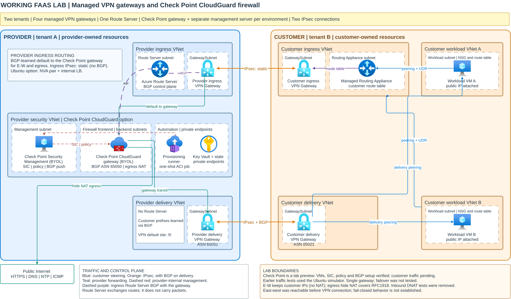

# CFWaaS: Cloud Firewall as a Service on Azure

A two-organization Azure **lab** for connecting customer networks to a
provider-operated firewall over managed VPN gateways.

**Start here: [Deploy from zero](docs/getting-started.md).**
The guide explains who does what, prerequisites, setup, customer onboarding,
login details, routing and verification in plain language.

> **Lab preview, not production-ready.** This is not an official Check Point
> or Microsoft product. A successful deployment is not proof of traffic
> inspection. A complete new-provider installation with all current Check Point
> features has not been qualified end to end. There is no universal,
> public one-click installer yet; the provider must publish its own release.

## What it does

| Firewall | Provider components | Evidence and limits |
|---|---|---|
| Check Point CloudGuard BYOL | One gateway, a separate Security Management Server, private state/vault and a one-shot managed runner | Bounded original-IP east-west ping/HTTP, matching firewall logs and Internet egress passed. Not VMSS or HA. |
| Ubuntu simulator (default) | Two simulator VMs and a load balancer | Lab routing experiments only; not proof of real Check Point behavior. |

- Provider and customer use **separate tenants and subscriptions**.
  This remains the default. An explicitly acknowledged **provider-only lab**
  can share the provider tenant/subscription using separate groups and VNets;
  it is not a cross-tenant isolation qualification.
- Neither organization grants the other Azure management permissions.
- Managed Azure VPN gateways, Routing Appliance and Route Server provide
  connectivity; no custom VM VPN/BGP relay substitutes for them.
- East-west traffic must keep the original source **and** destination IPs:
  no source NAT, destination NAT or masquerading in that path.
- Customer VNet additions/removals must not require per-VNet provider changes.
  Customer-owned UDRs, peering and gateway-transit configuration are still
  needed. The real Check Point lifecycle path remains to be qualified.

## Administrator experience

An additional **opt-in peering lab** is available in the provider portal's
**Deployment options** selector. It automatically deploys two customer VNets,
two `Standard_D4s_v6` workload VMs, and the existing Check Point VMSS/LB/management
release in separate customer/provider tenants. Each tenant authorizes its
appropriate administrator; provider managed identities never deploy customer
resources. Peering and static UDRs replace VPN, Route Server, Routing Appliance
and BGP for this option only. Actual MANA hardware/driver and original-source
connectivity are deployment verification gates, not assumed from a NIC flag.
See [peering setup and qualification](docs/getting-started.md#optional-automated-peering-lab).
This option is prepared and offline-tested, not live-qualified or production-ready.

1. **Provider platform administrator:** prepares a provider-owned release,
   approves Azure/Entra permissions and installs the control plane.
2. **Provider onboarding administrator:** opens the provider portal, creates
   a customer enrollment and securely delivers its deployment link and API
   credential.
3. **Customer administrator:** opens that Azure Portal link in the customer
   tenant and deploys customer resources. No local Python or CLI is needed.
4. **Provider firewall administrator:** uses **Reveal credential** to see
   customer UDR guidance, actual routing addresses, management/gateway IPs,
   usernames and the stored management password. Secrets clear after 30 seconds.
   The gateway uses the provider SSH key; no gateway password is managed.

The customer UDR next hop is the **customer Routing Appliance's actual assigned
IP**, not the provider firewall backend IP. See
[routing and connection details](docs/getting-started.md#6-find-routing-and-login-details).

## Architecture

[](architecture/working-lab-topology.svg)

[Full topology](architecture/working-lab-topology.svg) |
[Provider detail](architecture/working-lab-topology-provider.svg) |
[Customer detail](architecture/working-lab-topology-customer.svg) |
[Editable Draw.io source](architecture/working-lab-topology.drawio)

```text
Customer workload
  -> customer UDR -> managed Routing Appliance
  -> customer ingress VPN -> provider ingress VPN
  -> provider firewall -> provider delivery VPN
  -> customer delivery VPN -> destination workload
```

The provider has one ingress Route Server. The provider and customer delivery
VPN gateways exchange routes using BGP. The firewall advertises a default
route to the ingress Route Server; it does not need a static route for every
customer VNet.

[](architecture/working-lab-routing.svg)

[Routing explanation](docs/provider-routing-topology.md) |
[Editable routing diagram](architecture/working-lab-routing.drawio)

Addresses in these diagrams are **example lab private ranges**, not allocation
recommendations. Check for overlap before deploying. Isolated environments may
reuse ranges, but overlapping customer/provider networks within the same
environment are not supported automatically.

## Before spending money

A network environment includes **four VPN gateways, a Routing Appliance, one
Route Server, two customer workload VMs**, the chosen provider firewall and
supporting resources. Check Point adds two appliance VMs, private endpoints,
state storage, a vault, runner egress and container execution. Provider hosting
also has ongoing charges.

Check region support, quota, Azure Policy and Check Point Marketplace terms
before deployment. Check Point licensing is separate from Azure charges.
Stopping a VM does not remove all network or hosting charges. Review the
[prerequisites and cost checklist](docs/getting-started.md#1-prerequisites).

## Qualification limits

- Live-qualified Check Point delivery is **single gateway + management**, not VMSS,
  active/active, failover or state synchronization. An optional two-instance
  BYOL scale set (`checkpoint-vmss`) with internal and public load balancers is
  implemented and offline-tested, but **not yet live-qualified**.
- No production fail-closed, selective-denial or licensing-longevity claim.
- Earlier traffic bypassed the firewall before VPN convergence; later bounded
  successful tests do not establish that bypass is impossible.
- Generic lab NAT/policy assumes RFC1918 customer addresses; non-RFC1918
  support is not established.
- Public administrator access must use explicitly approved source addresses.
  Historical allow-any lab NSGs are not production guidance.
- Faster parallel Check Point/VPN provisioning and automatic overlap handling
  remain backlog items.

See [EW-44 through EW-46](docs/test-register.md#ew-44-customer-16-bidirectional-check-point-traffic-checks)
for the measured traffic, administrator-access and connection-details results.
Older experiments are evidence, not an alternative supported installation path.

## East-west performance

A tuned lab reached **about 2.2 Gbps** of firewall-inspected east-west traffic
in each direction, with **p50 10.6 ms / p99.9 39.2 ms** round-trip latency.
See [E-W performance results](docs/ew-performance-results.md) for the
topology, step-by-step results and the changes needed to get there.

The cross-VNet peering lab, with no VPN gateways on the path, measured
**p50 5.8 ms / p99.9 33.6 ms**, about half the VPN lab's median latency. See
[E-W latency results, peering lab](docs/ew-performance-results-peering.md).

Ping overstates application latency, because Check Point inspects every ICMP
echo as a new connection. On an open TCP connection, round trips measured
**p50 2.9 ms** in the VPN lab and **p50 0.7 ms** in the peering lab
([latency by protocol](docs/ew-performance-results-peering.md#latency-by-protocol)).

## Documentation

| Document | Use it for |
|---|---|
| [Deploy from zero](docs/getting-started.md) | New administrator checklist and step-by-step workflow |
| [Technical operator guide](provider-provisioning/README.md) | Release engineering, identities, settings and recovery |
| [Provisioning flow](docs/provider-provisioning-flow.md) | Provider/customer ownership and control-plane design |
| [Test register](docs/test-register.md) | What was actually measured and what remains unqualified |
| [E-W performance results](docs/ew-performance-results.md) | Measured east-west throughput and latency, and how to reproduce them |
| [E-W latency results, peering lab](docs/ew-performance-results-peering.md) | East-west latency through the cross-VNet peering lab, compared with the VPN lab |
| [Security and publication](SECURITY.md) | Handling sensitive files and reporting concerns |
| [Contributing](CONTRIBUTING.md) | Offline checks and publication boundaries |

## Repository name and compatibility

The repository is **`roie9876/CFWaaS`**. Clone it with:

```bash
git clone https://github.com/roie9876/CFWaaS.git
cd CFWaaS
```

Internal `FAAS_*` settings, `faas-*` resource names, API roles and historical
diagram labels are deliberately retained for compatibility. Renaming this
repository does **not** rename or redeploy Azure resources.

## License

Original CFWaaS contributions are [MIT licensed](LICENSE).
Check Point modules, appliance software, dependencies and vendor artwork retain
their own terms. See [Third-party notices](THIRD_PARTY_NOTICES.md); preserve
upstream licenses and notices in generated packages.
