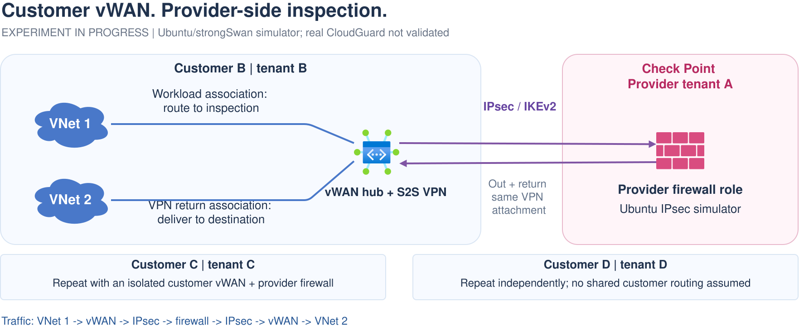

# Option 6: Customer vWAN with provider-side IPsec inspection

**Status:** experimental; E-W inspection has not worked. The static-prefix attempt
was rejected before tunnel establishment. The default-only BGP revision established
both IPsec and BGP sessions, but inter-VNet probes failed, including a separate
inspection-table-per-VNet experiment. Do not interpret successful resource
deployment or an established tunnel as successful inspection. Real Check Point
CloudGuard is not being qualified.

**Lifecycle:** this vWAN/IPsec lab was removed on 2026-10-19 at the user's
request. Retention statements and routing snapshots below describe historical
experiments, not currently running resources. See the
[final summary](../../../../docs/final-summary.md) for later reference/gateway tests.

## Ownership and traffic



[Edit in Draw.io](../../../../docs/diagrams/06-customer-vwan-ipsec.drawio).
[Open full-size image](https://github.com/roie9876/CFWaaS/raw/refs/heads/main/docs/diagrams/06-customer-vwan-ipsec.svg).

Customer B owns:

- Standard vWAN and a managed virtual hub.
- The hub's site-to-site VPN gateway.
- Workload VNets and private endpoint VMs.

Provider A owns the firewall/VPN endpoint. **The firewall itself terminates
IPsec. No separate Azure VPN Gateway is required in A.**

The intended protected flow is:

```text
VNet 1 -> customer vHub -> IPsec -> provider firewall
       -> IPsec -> customer vHub -> VNet 2
```

The reverse direction must follow the same inspection service.

## Why this might avoid the earlier loop

The previous failed design returned traffic from an ordinary, directly
connected firewall VNet spoke. Here inspected traffic returns through a
**VPN attachment**, which has a different hub routing association.

The experiment keeps the VPN branch associated with `defaultRouteTable`, as
Microsoft documents. Customer VNet connections use an inspection association.
It then checks whether protected destinations use the VPN before inspection and
the destination VNet connection after decryption/return.

### Explicit steering configuration

| Incoming attachment | Associated table | Required winning route |
| --- | --- | --- |
| Customer workload VNet | Inspection | BGP `0.0.0.0/0` toward provider VPN |
| Provider VPN return | Default delivery | Destination VNet prefix toward its hub connection |

Customer VNet prefixes propagate to **Default**, not **Inspection**. The
provider advertises only the default toward Azure and learns private customer
prefixes in the opposite direction. Wildcard selectors on route-based IPsec
avoid per-VNet encryption-domain updates.

If a more-specific direct route bypasses the provider for a protected
destination, the design fails acceptance. A default route also steers other
nonlocal destinations toward the provider; this lab does not enable or qualify
public Internet egress.

This is a testable hypothesis, not proof that changing transport alone fixes
routing. Prefix overlap, propagation, route preference, IPsec selectors and
firewall hairpin behavior must all work together.

## Implementation and acceptance

See the [isolated simulator guide](../../ipsec-vwan-lab/GUIDE.md).

The test uses one provider Ubuntu/strongSwan VM, two private customer VMs and
both managed gateway tunnel endpoints. Acceptance requires the following checks;
not all could be completed because the positive inspected-flow prerequisite failed:

1. Direct VNet-to-VNet baseline.
2. Established IKE and CHILD SAs.
3. Actual inspection and delivery hub routes.
4. Bidirectional HTTP with correct destination and preserved original source.
5. Low-TTL ICMP and firewall forwarding counters.
6. Provider forwarding denial with IKE and BGP still established.
7. BGP default withdrawal and IPsec shutdown: E-W traffic must fail closed.
8. Restoration must recover connectivity.
9. Third-VNet route learning, inspected traffic and removal/withdrawal with no
   provider configuration change.

Core resources are not automatically torn down on failure. The lifecycle test
removes only its temporary probe resources; the core lab remains for debugging.

## What the first attempt actually showed

Two native-vWAN HTTP baseline requests passed before inspection steering.
Azure then rejected the VPN connection because a declared remote-site prefix
overlapped a local VNet (`ConnectionOverlappingAddressSpaces`). No IKE,
inspected HTTP, firewall-negative or loop-avoidance test passed in that attempt.
The baseline is not evidence that IPsec inspection worked.

## BGP revision and per-VNet route-table experiment

On 2026-10-19, the lab tested a separate inspection table for each workload VNet.
Each table received the provider's BGP default route; customer prefixes continued
to propagate to Default. The VPN kept its Default association. The existing VPN's
inspection propagation label was added so its routes reached both new tables.
No additional hub, gateway, VM, subnet UDR or provider configuration was introduced.

Before that change, both workload connections were associated with Default.
The user confirmed using this live configuration as a fresh native-routing
baseline, rather than assuming the earlier shared-inspection association remained.

| Measurement | Native Default-table baseline | Separate inspection tables |
| --- | --- | --- |
| HTTP, VNet A to VNet B | 3/3 passed | 0/3; timed out |
| HTTP, VNet B to VNet A | 3/3 passed | 0/3; timed out |
| Inter-VNet ICMP replies, both directions combined | 6/6 | 0/6 |
| Provider capture of target E-W packets | 0 | 0 |

Both IPsec tunnels and BGP sessions remained established. The provider learned
both workload prefixes. Both workload NICs showed an active VPN default and no
active route for the other workload VNet's specific prefix. The inspection and
delivery effective-route checks also passed.

During the separate-table probes, both workloads successfully pinged the provider
before and after their E-W tests: eight echo requests received eight replies. The
provider capture covered the probe intervals and recorded 16 control packet lines
(requests and replies), but no matching workload-to-workload packets. Its
forwarding SYN counter remained zero. Provider routing, VPN and firewall
configuration hashes were unchanged across the baseline and separate-table phases.

**Result:** separate per-VNet hub tables did not fix the inspected E-W path.
The exact Azure-internal forwarding decision or drop remains unverified; no loop
was captured in this experiment. Firewall-block and VNet-lifecycle acceptance
tests were not completed because no positive inspected flow was established.
The new table associations and core lab were retained for inspection, not
automatically removed or restored to the native-bypass baseline.

### Propagation repair after route-table cleanup

A later read-only snapshot found that VPN propagation targeted only the old
shared inspection table, with no propagation label. Both per-VNet inspection
tables then reported empty effective routes. After the user authorized repair,
the VPN's propagated table IDs were replaced with explicit references to the two
remaining per-VNet inspection tables. No unused table was recreated. The VPN's
Default association, workload associations, delivery table and VPN link settings
were preserved.

Both tables regained the provider VPN default, and both workload NICs again
showed VPN-default steering without a specific route to the other workload VNet.
The retest still produced six HTTP timeouts and zero of six inter-VNet ICMP
replies. Provider control probes received eight of eight replies; the provider
capture covered both test intervals and recorded 16 control packet lines but
zero target E-W packet lines. Both IPsec and BGP sessions stayed established,
and provider configuration hashes were unchanged.

The propagation configuration was repaired, but end-to-end inspection was not.
This does not establish the original Azure-internal failure mechanism.

During diagnostics, simultaneous effective-route requests for different tables
on the same hub returned the same asynchronous operation ID and result. Subsequent
table-specific verification used sequential requests with distinct operation IDs.

## Cost and qualification boundaries

Unlike options 1/2, this option incurs customer vWAN/S2S gateway charges and
encrypted-tunnel processing overhead. It avoids a second provider Azure VPN
Gateway, not all gateway costs.

The initial experiment covers IPv4 inter-VNet traffic, not Internet egress,
published ingress, throughput or provider firewall HA. Customer C/D are
independent repetitions in the diagram, not resources in this small lab.

No explicit Microsoft end-to-end support statement was verified for this exact
remote-firewall E-W hairpin pattern. Component support is not a production
support guarantee; successful simulator tests would still require Microsoft
and Check Point qualification.

One working environment would not qualify hundreds of isolated firewall/VPN
cells in one customer hub. Microsoft's branch routing constraints include a
shared default association and consistent branch propagation. Multi-environment
isolation, overlapping addresses and hub/WAN sharding need separate design and
scale tests.

## References

- [vHub routing associations and propagation](https://learn.microsoft.com/azure/virtual-wan/about-virtual-hub-routing)
- [Create S2S VPN connections](https://learn.microsoft.com/azure/virtual-wan/virtual-wan-site-to-site-portal)
- [Custom IPsec policy](https://learn.microsoft.com/azure/virtual-wan/virtual-wan-custom-ipsec-portal)
- [Learned default-route propagation](https://learn.microsoft.com/azure/virtual-wan/virtual-wan-faq)
- [strongSwan route-based VPN](https://docs.strongswan.org/docs/latest/features/routeBasedVpn.html)
