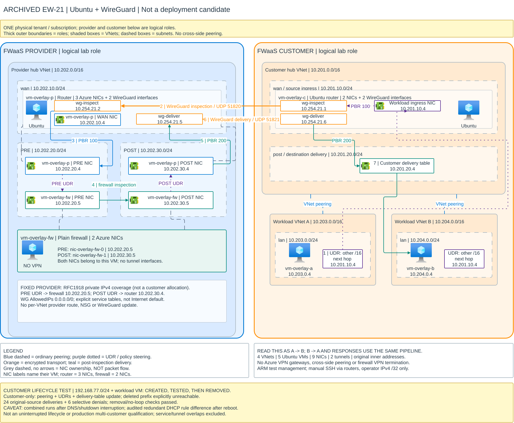

> Archived by user decision 2026-10-26; not deployment candidate; historical measurements preserved; repository archive does not delete Azure resources

# EW-21: open-source Ubuntu overlay inspection

**Result: passed and retained.** The isolated lab uses two ordinary Ubuntu
routers with WireGuard, a separate plain Ubuntu firewall, and two workload VMs.
No paid VyOS/F5 image, Azure managed VPN gateway or managed Routing Appliance
was deployed. The retained EW-18 reference was not modified.

**Customer-independence continuation:** real VNet addition, source-preserving
inspection/denial/recovery, and removal checks were demonstrated without
per-VNet provider service-configuration updates. Evidence spans interrupted
runs and post-restart checks; see the [qualification caveat below](#customer-independence-continuation).

This alternative changes the transport requirement: dedicated hub VMs terminate
the tunnels, rather than Azure VPN Gateways. It is not a replacement satisfying
EW-18's original all-managed-VPN-endpoints constraint.

## Topology



[Full-size SVG](ew21-ubuntu-overlay.svg) ·
[Editable Draw.io](ew21-ubuntu-overlay.drawio) ·
[Active EW-18 guide](../../docs/ew18-managed-vpn.md) ·
[Repository README](../../README.md)

The visual style follows the [FWaaS reference](https://github.com/roie9876/fwaas):
blue provider, orange customer, nested VNet/subnet boundaries and Azure icons.
The contents show the actual EW-21 lab, not the reference's additional spokes
or applications. Both logical roles were deployed in one physical tenant and
subscription. Green Azure NIC icons identify interfaces on existing VMs, not
extra VMs; the diagram has five VM icons. The provider PRE and POST router NICs
both belong to `vm-overlay-p`; `vm-overlay-fw` is the separate firewall VM.
Each provider NIC is labelled with its owning VM. Grey dashed attachment lines
without arrows show NIC ownership, not packet flow. The router has three Azure
NICs (WAN `10.202.10.4`, PRE `10.202.20.4`, POST `10.202.30.4`), plus two
guest WireGuard interfaces. The firewall has exactly two Azure NICs:
`nic-overlay-fw-0` (PRE `10.202.20.5`) and `nic-overlay-fw-1` (POST
`10.202.30.5`). Its separate VM card identifies both interfaces.
The yellow lifecycle panel describes a temporary fifth VNet and sixth VM
that were created and removed. They are not part of the retained resource count.

## Historical SSH access

These commands preserve the former README instructions, not an active
deployment recommendation. Run **from this repository's root on the authorized
lab workstation**; archiving did not relocate controllers or access material.

```bash
source .local/lab-ssh.env
export SSH_CONFIG="$EW21_SSH_CONFIG"

ssh -F "$SSH_CONFIG" ew21-customer
ssh -F "$SSH_CONFIG" ew21-provider
ssh -F "$SSH_CONFIG" ew21-fw
ssh -F "$SSH_CONFIG" ew21-a
ssh -F "$SSH_CONFIG" ew21-b
```

| Alias | VM | Connection |
| --- | --- | --- |
| `ew21-customer` | `vm-overlay-c` | Customer router public endpoint |
| `ew21-provider` | `vm-overlay-p` | Provider router public endpoint |
| `ew21-fw` | `vm-overlay-fw` | Private firewall through provider router |
| `ew21-a` | `vm-overlay-a` | Private workload A through customer router |
| `ew21-b` | `vm-overlay-b` | Private workload B through customer router |

All five aliases were verified against their expected hostnames on 2026-10-25.
Public SSH was allowed only from the approved operator IPv4 `/32`; changing
networks/public IP may require updating that allowance. Password authentication
remains disabled, host keys are pinned from Azure, and agent forwarding is
disabled. Private VM commands require their router jump host to be running.

**No private keys are stored in Git.** `.local/lab-ssh.env`, run-specific SSH
configurations, private keys and `known_hosts` remain ignored/local. The helper
contains config-file paths, not key contents. A fresh clone does not include
these artifacts: use authorized secure transfer or reprovision access. If the
helper is missing on the original workstation, locate the private lab's
`results/<run>/ssh-access/ssh_config` and set `EW21_SSH_CONFIG` accordingly.
Never paste private keys into documentation, chat or an issue.

## Packet path

Requests and application responses follow the same inspection pipeline:

```text
source workload -> customer router PRE -> inspection tunnel
                -> provider router PRE -> plain firewall
                -> provider router POST -> delivery tunnel
                -> customer router POST -> destination workload
```

There are five VMs, four VNets, two public router IPs, nine NICs and four route
tables. Workloads peer only with the customer hub. There is no customer/provider
or direct workload-to-workload peering.

## What separates inspection from delivery

The packet keeps its original inner source and destination. Arrival interfaces,
not destination prefixes alone, select the stage:

| Router context | Arrival | Forwarding action |
| --- | --- | --- |
| Customer PRE | Workload-facing NIC | Inspection tunnel |
| Provider PRE | Inspection tunnel | Firewall PRE NIC |
| Provider POST | Firewall POST-facing NIC | Delivery tunnel |
| Customer POST | Delivery tunnel | Delivery NIC and ordinary spoke peering |

Guest policy routing is only one layer. Azure subnet UDRs must also direct
provider PRE egress to the firewall PRE NIC, and firewall POST egress to the
provider POST NIC. Without them, the provider's effective route selected the
default private-space drop rather than the intended service hop. The controller
checks the exact active UDRs before and after the traffic test.

Router forwarding ACLs allow only the stage-specific interface pairs.
Protected-flow policy tables have terminal unreachable defaults. The routers
do not connection-track inner double-pass flows; the firewall remains a
separate forwarding/filtering VM with no tunnel termination.

The current provider service tables, subnet UDRs and forwarding NSGs cover the
three RFC1918 ranges once, not individual customer VNets. Each dedicated
WireGuard interface retains a single authenticated peer with `AllowedIPs`
`0.0.0.0/0`; explicit policy tables keep service forwarding separate from the
outer tunnel/management path. This does not replace the routers' Internet
default routes. Customer delivery permits only onboarded VNet prefixes, with
terminal rejection for removed destinations.

## Measured qualification

The completed run contains eleven phases, with three HTTP attempts per
initiation direction per phase.

| Phase | A-to-B HTTP | B-to-A HTTP |
| --- | --- | --- |
| Allowed | 3/3 passed | 3/3 passed |
| Block new A-to-B SYNs at the firewall | 0/3 passed | 3/3 passed |
| Restore A-to-B | 3/3 passed | 3/3 passed |
| Block new B-to-A SYNs at the firewall | 3/3 passed | 0/3 passed |
| Restore B-to-A | 3/3 passed | 3/3 passed |
| Firewall deny-all | 0/3 passed | 0/3 passed |
| Restore firewall forwarding | 3/3 passed | 3/3 passed |
| Inspection tunnel down | 0/3 passed | 0/3 passed |
| Restore inspection tunnel and routes | 3/3 passed | 3/3 passed |
| Delivery tunnel down | 0/3 passed | 0/3 passed |
| Restore delivery tunnel and routes | 3/3 passed | 3/3 passed |

All **66 HTTP outcomes** matched expectations: **42 successful deliveries**
and **24 expected denials**. Every phase also passed each workload's local
HTTP control. Every successful remote response identified the correct receiver
and original workload source.

Each selective-denial rule recorded **9 firewall DROP hits**. Firewall PRE
capture recorded **476 packet observations**, including both original
initiation directions, without correlated declining-TTL recirculation.
Packet observations are not a count of unique application flows.

Final postflight verified IP forwarding, no guest NAT, no firewall VPN
interfaces/XFRM state/listeners, restored tunnels and removal of temporary
firewall blocks. A separate live check confirmed all five VMs running, all
guest agents ready, all five tenant-managed `MDE.Linux` extensions Succeeded,
no active capture worker or paging-response temporary files, and an active
firewall forwarding service. EW-18 and all four of its gateways remained
present/Succeeded; EW-19 remained absent.

## Recovery and management findings

On 2026-10-26, manual ping and HTTP failed because the customer router's
interface-based policy rules and delivery routes were absent, despite healthy
WireGuard handshakes and an active (exited) forwarding unit. Network-manager
reconciliation/restart can remove application-managed rules and device-bound
routes; the stage ACL then drops traffic rather than bypassing inspection.

The repair preserves foreign routes/rules in networkd configuration and binds
the forwarding service to networkd restarts, waiting for the physical interfaces
before restoring the saved service policy. Deliberate networkd restarts on both
routers and the firewall verified automatic route/rule recovery. Subsequent
tests passed four ICMP requests per initiation direction with zero loss, plus
HTTP correct-receiver/original-source checks in both directions. This is a
targeted network-manager recovery test, not a complete reboot/failover matrix.
It is a post-qualification repair; it does not retroactively change the earlier
provider-freeze evidence.

An early interruption test failed closed but did not recover: Linux removed
device-bound policy routes when the tunnel interface went down. Recovery now
reinstalls the owned routing and forwarding configuration, not just the link's
UP state. The full matrix above was rerun successfully with that fix.

WireGuard freshness is measured against the guest's observation timestamp,
not the operator's clock after a slow management response. Large Run Command
results are compressed and paged to avoid truncating packet evidence.
Capture PID records include boot identity so recovery cannot kill an unrelated
process that reused a PID after a VM restart.

Management uses authenticated Azure Run Command with group/VM ownership checks.
Automated testing does not require public SSH. At the user's request, manual
SSH is now enabled on the two router public endpoints from the approved
operator IPv4 `/32` only. The firewall and workloads remain private and use
their respective routers as SSH jumps. Key-only authentication, ARM-pinned
host keys and disabled agent forwarding are retained. All five connections
were verified. See [the historical connection commands](#historical-ssh-access);
the helper/configurations and private keys stay ignored/local.

The private guests require outbound connectivity for the tenant's security agent
and OS updates. Their primary subnets explicitly enable default outbound access;
NSGs restrict Internet egress to web ports plus Azure DNS/guest-agent allowances.
They have no public IPs. This is a lab egress exception, not a production egress
design. Platform Internet egress is distinct from the protected inner traffic,
whose original addresses were verified end to end.

## Scope and limits

### Customer-independence continuation

A subsequent experiment is testing a fixed provider service path with
customer-controlled VNet onboarding and delivery. The provider's one-time
baseline covers RFC1918 private IPv4 ranges, not a customer-specific allocation.
Overlapping service/tunnel networks and public IPv4 VNet ranges are excluded.

After baseline configuration, provider Azure models and guest routing,
WireGuard peer settings, forwarding rules, source hashes and persistent network
configuration are fingerprinted. The customer then creates a real VNet,
subnet and workload VM in a previously unconfigured `192.168.77.0/24` range,
adds customer-only peerings/UDRs and updates its router's delivery table.
Neither provider topology nor provider routing/NSGs/WireGuard settings may
change during that lifecycle.

New-VNet source-preserving traffic, selective denial in each initiation
direction and both recoveries passed, with no provider configuration drift
detected during those stages. A workstation DNS failure interrupted the first
attempt; guarded restoration removed its temporary resources. A subsequent
run completed the five traffic phases but was interrupted during removal/
deleted-prefix checks when the customer router was no longer running.

At the interruption, all five original VMs were deallocated and the temporary
VNet/VM were absent. The scoped two-hour activity log did not identify a
shutdown actor. The user authorized restarting the existing VMs; no security
or shutdown policy was disabled.

The remaining removal checks then **passed**: the former prefix was explicitly
unreachable at the customer delivery table, bounded-TTL captures showed no
recirculation, and original A/B traffic remained healthy. Customer-side subnet
NSGs required private forwarding allowances independent of current peering
membership; without them, packets to a deleted VNet were dropped before entering
the inspection path. No provider rule update was needed.

All five traffic phases passed: three attempts per direction per phase, yielding
24 original-source deliveries and six expected selective denials. Firewall
captures contained 60, 39, 60, 39 and 60 observations for allowed, deny-A,
recover-A, deny-new and recover-new respectively. Final readback confirmed the
new VNet, VM, disk, NIC, route table, owned NSG and both peerings were absent,
the temporary A route was removed, and the original five VMs/four VNets remained
running/present. A tenant-created, now-unassociated subnet NSG was retained.

**Qualification caveat:** this is combined evidence across an interrupted run
and post-restart removal checks, not one uninterrupted lifecycle. During the
traffic phases the complete frozen provider fingerprint matched. After restart,
one redundant provider-router DHCP INPUT-allow rule was absent while INPUT
policy remained ACCEPT; all other compared provider cloud/guest configuration
matched. This exception is recorded rather than silently resetting the freeze.
No provider service/topology/routing/NSG/WireGuard configuration was changed to
onboard or remove the customer VNet. An uninterrupted rerun and production
multi-customer isolation remain separate qualifications.

Packet capture, authenticated Run Command measurements, and preinstalled
firewall-test operational flags are audited measurement exceptions, not
per-VNet provider onboarding changes. Installed test rules remain included
in the fingerprint. Temporary customer resources are removed at the end;
the original EW-21 resources and historical qualification evidence are retained.

This is a two-workload, static-prefix IPv4/HTTP simulator qualification in one
physical tenant. It does not qualify real Check Point/F5, cross-tenant deployment,
fleet onboarding, BGP lifecycle, HA, throughput, load, MTU/fragmentation, UDP,
ICMP, IPv6 or a full-router reboot matrix. Persistent guest units are installed,
but broader reboot persistence remains a separate test.

Local validation passed **31 focused tests**, Bicep compilation and **12 Checkov
checks with zero failures**. Three explicit scanner exclusions cover ARM guest
operations and unavailable host-encryption feature registration; managed disks
retain platform encryption, and Trusted Launch/Secure Boot/vTPM remain enabled.
No subscription feature, identity grant or tenant security policy was changed.

The lab remains deployed for investigation. Environment-bound controllers,
approvals, keys, host metadata and raw evidence remain private/local.

[Test register](../../docs/test-register.md) · [Managed-gateway reference](../../docs/ew18-managed-vpn.md) · [Prototype index](README.md)
