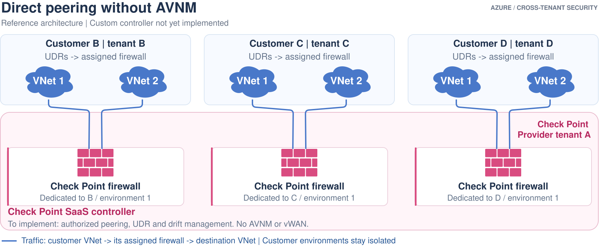

# Option 1: Direct peering without AVNM, managed by your own controller

**Status:** documented forwarding pattern, matching option 2's lab-tested
dataplane. A production controller replacing AVNM is **not implemented here**.
There is no executable deployment command for this option.

## Ownership and traffic

[Edit in Draw.io](../../../../docs/diagrams/01-direct-peering-controller.drawio).
[Open full-size image](https://github.com/roie9876/CFWaaS/raw/refs/heads/main/docs/diagrams/01-direct-peering-controller.svg).
Blue clouds are workload VNets; pink brick symbols mark the Check Point
firewall role. The controller is management only, not a packet hop.

The packet path is unchanged from option 2. Only the management implementation
changes; there is no vWAN or AVNM service in this design.

## Controller work still required

- Customer consent, scoped identities and linked-resource authorization.
- An authoritative registry keyed by customer tenant, environment and region.
- Creation/reconciliation of both peering directions and workload UDRs.
- Safe coexistence with customer routes, policy, locks and other controllers.
- Idempotent onboarding, retries, rollback, drift detection and offboarding.
- Effective-route checks, firewall telemetry and positive/negative probes.
- Audit history, ownership tags, rate limiting and concurrency control.

## Trade-off

Avoids AVNM's service charge, not networking or firewall charges. It exchanges
that charge for engineering, reliability and operations responsibility.
Dedicated firewall cells and one peering relationship per protected VNet remain.

## References

- [VNet peering and service chaining](https://learn.microsoft.com/azure/virtual-network/virtual-network-peering-overview)
- [Option 2: same dataplane with AVNM](../../../../deployments/02-direct-peering-avnm/README.md)
- [Monitoring model](../../../../docs/monitoring.md)
