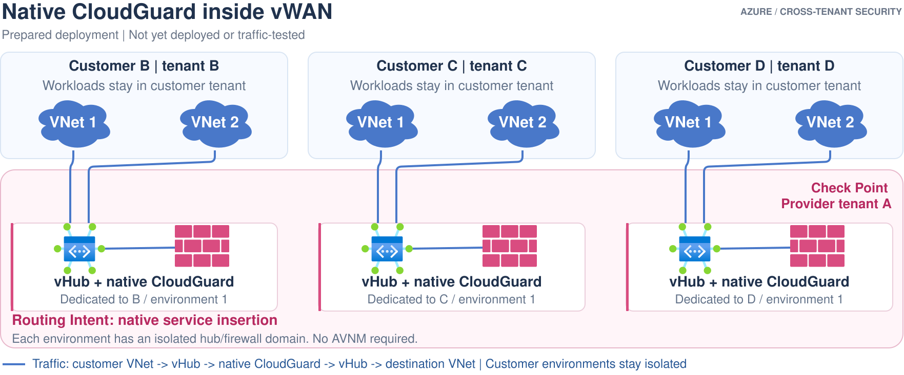

# Option 3: Native CloudGuard in provider-owned vWAN

**Status:** staged automation is prepared and locally validated. It has
**never been deployed or traffic-tested**. Execution must remain explicitly
gated until a new environment-specific plan, permissions and costs are approved.

## Ownership and traffic

[Edit in Draw.io](../../../../docs/diagrams/03-vwan-cloudguard.drawio).
[Open full-size image](https://github.com/roie9876/CFWaaS/raw/refs/heads/main/docs/diagrams/03-vwan-cloudguard.svg).
Each Azure vHub icon has its own native CloudGuard firewall. No inter-customer
hub links are drawn; shared flat transit is not implied.

The managed hub sends protected traffic through the native integrated NVA and
delivers it onward. This is **not** an ordinary firewall VM in a third spoke.
No separate Azure Firewall is implied by the diagram.

## Implementation

The [prepared CloudGuard package](../../../../cloudguard-vwan-lab/GUIDE.md) retains its
original path. It uses the publisher's integrated managed application and a
separate management-server deployment, not an Ubuntu substitute.

The initial package targets one provider hub and two customer workload VNets,
not the entire B/C/D fleet shown conceptually above.

## Qualification before deployment

- Confirm publisher support, Marketplace eligibility, regional availability,
  supported versions and licensing.
- Approve customer/provider authorization and all publisher-required roles.
- Review native NVA HA, capacity, management access and recovery.
- Enable and verify Private/Internet Routing Intent as required.
- Validate cross-tenant attachment, effective forwarding, isolation, internet
  handling, policy/NAT and real negative controls.
- Reassess environment-specific feature prerequisites; do not silently register
  subscription features.

## Scale and isolation

Each hub has at most one Private Traffic policy and one Internet Traffic policy,
each with a single next-hop resource. Do not assume one hub can select hundreds
of environment-specific firewalls.

The diagram deliberately shows isolated domains. Sharing a flat vWAN across
overlapping customers is not an isolation strategy; a production hub/WAN layout
must be qualified against tenancy, overlap, routing and capacity requirements.
Expect hub/connection/data-processing charges in addition to firewall costs.

## References

- [Integrated NVA partners](https://learn.microsoft.com/azure/virtual-wan/about-nva-hub)
- [Routing Intent and policies](https://learn.microsoft.com/azure/virtual-wan/how-to-routing-policies)
- [Cross-tenant vHub connections](https://learn.microsoft.com/azure/virtual-wan/cross-tenant-vnet)
