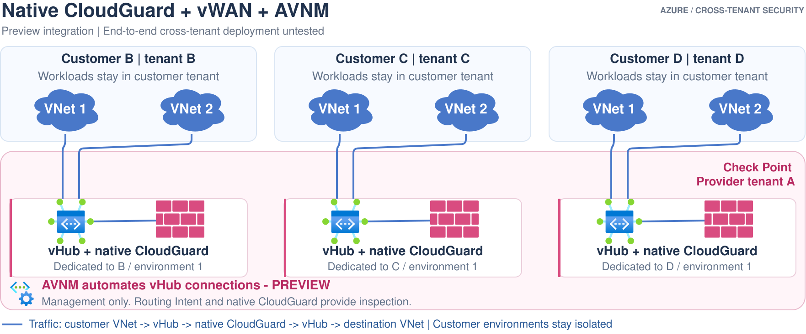

# Option 4: Native CloudGuard/vWAN with AVNM automation

**Status:** design only. Azure's native AVNM-to-vWAN hub connection integration
is **preview** as verified on 2026-10-18. The combined cross-tenant CloudGuard
deployment is not implemented or tested here.

## Ownership and traffic

[Edit in Draw.io](../../../../docs/diagrams/04-vwan-avnm-preview.drawio).
[Open full-size image](https://github.com/roie9876/CFWaaS/raw/refs/heads/main/docs/diagrams/04-vwan-avnm-preview.svg).
The separate AVNM caption is marked **PREVIEW** and is not in the traffic path.
Every customer's isolated hub has its own native CloudGuard firewall.

This is option 3's dataplane with an additional management service. AVNM
orchestrates vHub connections and connection policies; Routing Intent/native
CloudGuard provides inspection. AVNM is not in the packet path.

## Boundaries

- Do not imply the preview has the availability/SLA of a qualified production
  service.
- Cross-tenant support of the combined feature set must be verified explicitly;
  separate component support is not an end-to-end qualification.
- Do not enable direct-spoke connected-group/mesh connectivity for protected
  traffic: Microsoft documents that it can take precedence over hub inspection.
- AVNM's vHub integration does not enforce connectivity in the same way as
  ordinary peering enforcement. Reconnection is attempted on a later regional
  configuration deployment, not a promised continuous repair interval.
- No deployment command is supplied. Do not turn on the prepared option 3
  package expecting it to implement this preview option.

## References

- [AVNM and vWAN integration, limitations and preview status](https://learn.microsoft.com/azure/virtual-wan/virtual-network-manager-integration)
- [Configure a vWAN hub for AVNM](https://learn.microsoft.com/azure/virtual-network-manager/configure-virtual-wan-hub-for-network-manager)
- [Option 3](../03-vwan-cloudguard/README.md)
