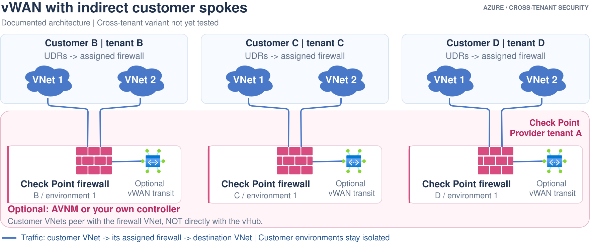

# Option 5: Ordinary vWAN with indirect customer spokes

**Status:** Microsoft documents the indirect-spoke pattern. This project's
cross-tenant variant is not deployed or traffic-tested. No executable
deployment is supplied.

## Ownership and traffic

[Edit in Draw.io](../../../../docs/diagrams/05-vwan-indirect-spokes.drawio).
[Open full-size image](https://github.com/roie9876/CFWaaS/raw/refs/heads/main/docs/diagrams/05-vwan-indirect-spokes.svg).
The vHub icons are optional transit legs behind the ordinary firewalls, not
native firewall integrations. Each is shown within its own isolated environment;
shared cross-customer transit is not implied.

**Protected workload VNets do not connect directly to the vHub.** They peer
with their assigned firewall VNet. The vWAN transit leg is optional for the
inter-VNet inspection path; every environment needs a separately qualified
transit/isolation arrangement if that leg is added.

## Why choose it?

Useful when vWAN is already needed for branch or wider transit. It does not
require the firewall to be a native in-hub NVA. For only inter-VNet inspection,
options 1/2 are simpler because this design adds transit that the basic packet
path does not need.

## Routing responsibilities

- Customer workload UDRs steer to the assigned firewall.
- The firewall delivers to its customer spokes through direct peering.
- vWAN needs explicit routing toward indirect-spoke prefixes.
- Prevent a learned/default route from sending firewall egress back to the hub
  and reintroducing a loop. Follow the documented NVA/default-route settings.
- Optional AVNM can manage the **ordinary peerings and workload UDRs**; that is
  separate from option 4's preview vHub-connection automation.
- Do not flatten isolated customer environments into shared overlapping transit.

## References

- [Indirect spoke routing](https://learn.microsoft.com/azure/virtual-wan/indirect-spoke-architecture)
- [Supported/unsupported external-NVA cases](https://learn.microsoft.com/azure/virtual-wan/static-routes#routing-traffic-to-an-nva-in-a-spoke-virtual-network)
- [Option 1: direct peering without AVNM](../01-direct-peering-controller/README.md)
- [Option 2: direct peering with AVNM](../../../../deployments/02-direct-peering-avnm/README.md)
