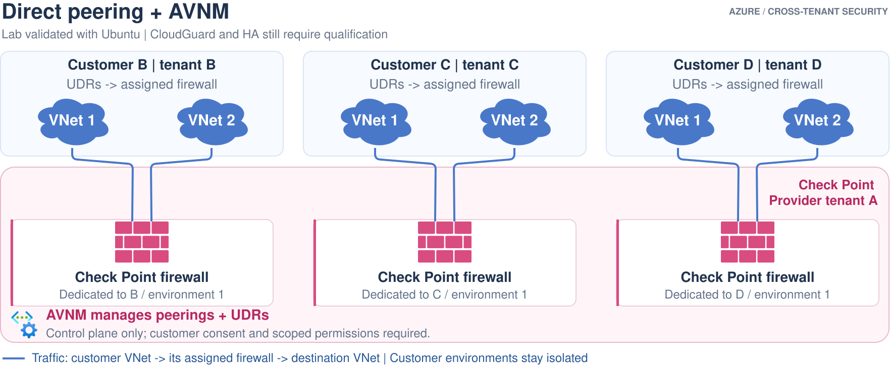

# Option 2: Direct peering managed by AVNM

**Status:** cross-tenant management, forwarding and isolation passed a small
Ubuntu simulator lab. Real Check Point gateways, HA and production scale remain
unqualified.

**Lifecycle:** the lab was decommissioned on 2026-10-19 at the user's request.
The successful measurements below are historical; no lab resources remain
deployed for inspection.

## Ownership and traffic

[Edit in Draw.io](../../docs/diagrams/02-direct-peering-avnm.drawio).
[Open full-size image](https://github.com/roie9876/CFWaaS/raw/refs/heads/main/docs/diagrams/02-direct-peering-avnm.svg).
The cloud icons represent workload VNets; the pink brick symbols represent the
Check Point firewall role, not Azure Firewall. Two VNets per customer are shown
for readability, not the exact lab inventory.

Return paths must be symmetric. AVNM's separate control-plane caption requires
authorized cross-tenant scope/caller access; AVNM does not forward packets.

## How it works

1. Create a dedicated provider firewall/security VNet for each customer
   environment.
2. Establish AVNM's two-way cross-tenant scope consent.
3. Assign the environment's workload VNets to its network group.
4. Use hub-and-spoke connectivity with **no direct-spoke mesh**.
5. Use workload-subnet UDRs with the assigned firewall as next hop.
6. The firewall forwards to destination VNets using direct peering routes.
   Do not apply workload steering back to the firewall subnet itself.

The [AVNM lab implementation guide](../../avnm-faas-lab/GUIDE.md) retains its original path
for local run recovery. Its runtime configuration and evidence are local-only.
Follow its sanitized setup documentation before any new execution.

## What it buys and what it does not

- No vWAN, customer routing VM or customer VPN gateway is required.
- AVNM manages peerings/routes but does not eliminate physical peering count.
- AVNM managed-VNet charges are additional to firewall and peering costs.
- A production reconciler and traffic/inspection probes are still needed.
- Existing more-specific routes can bypass a firewall; verify effective routes.
- `UseExisting` route-table mode does not track manual modifications.
- Cross-tenant consent is not a substitute for caller RBAC on linked resources.

## Evidence

The local simulator lab used two isolated environments with three workload
VNets each. It passed 150 HTTP checks, including selective firewall blocking
and restoration, plus 30 ICMP checks. Only the anonymized summary is published;
resource IDs, accounts, IP inventories and raw results remain excluded.

## References

- [AVNM cross-tenant support](https://learn.microsoft.com/azure/virtual-network-manager/concept-cross-tenant)
- [Connectivity configurations](https://learn.microsoft.com/azure/virtual-network-manager/concept-connectivity-configuration)
- [UDR management and UseExisting](https://learn.microsoft.com/azure/virtual-network-manager/concept-user-defined-route)
- [Monitoring model](../../docs/monitoring.md)
