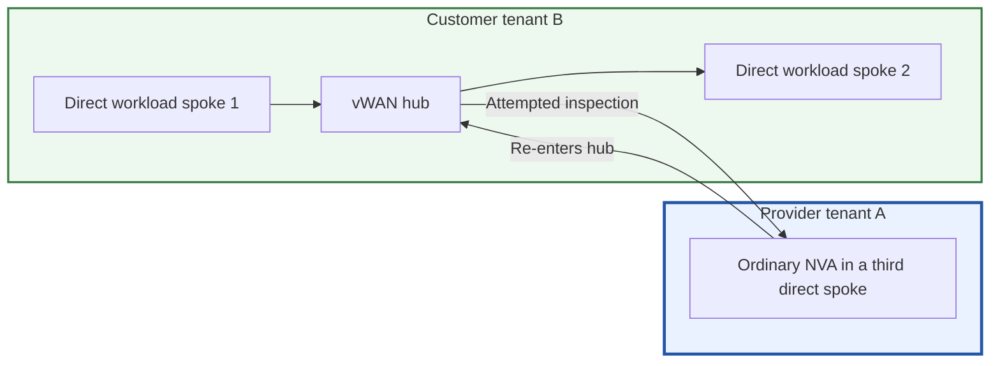

# Architecture, status and evidence

See the [final research summary](final-summary.md) for the complete disposition,
including the later native Azure Firewall reference and classic VPN-gateway/
direct-private-IP UDR experiments. This page retains the six deployment patterns.

## Goal

Keep firewall ownership/operations in provider **tenant A** while customers
retain workload ownership in **tenants B, C, D, ...**. The isolation unit is
`customer + environment + region`, with a dedicated logical firewall deployment
for each isolated environment.

## Evidence levels

| Label | Meaning |
| --- | --- |
| Lab-tested | Actual resources and packet checks passed for the stated scope |
| Prepared | Automation/configuration compiled or tested locally; no runtime proof |
| Documented pattern | Primary documentation supports the architecture; our combination is untested |
| Preview | A changing preview capability, not a production/SLA commitment |
| Experimental | Exact routing combination needs live evidence and vendor support qualification |
| Rejected | Failed or explicitly unsupported for our stated traffic pattern |

Published test counts are anonymized summaries, not a substitute for deploying
and qualifying the exact Check Point version, HA topology, policies and region.
No private run identifiers or tenant/resource inventories are published.

## Deployment navigation

1. [Direct peering without AVNM, own controller](../archive/unvalidated-proposals/deployments/01-direct-peering-controller/README.md):
   same dataplane; controller is not implemented.
2. [Direct peering + AVNM](../deployments/02-direct-peering-avnm/README.md):
   lab-tested with Ubuntu simulators.
3. [Native CloudGuard + vWAN](../archive/unvalidated-proposals/deployments/03-vwan-cloudguard/README.md):
   prepared integrated deployment, never executed.
4. [Native CloudGuard/vWAN + AVNM](../archive/unvalidated-proposals/deployments/04-vwan-avnm-preview/README.md):
   unimplemented preview combination.
5. [vWAN + indirect spokes](../archive/unvalidated-proposals/deployments/05-vwan-indirect-spokes/README.md):
   documented architecture, untested cross-tenant variant.
6. [Customer vWAN + provider IPsec](../archive/failed-scenarios/deployments/06-customer-vwan-ipsec/README.md):
   new remote-firewall hairpin experiment; Ubuntu/strongSwan, not real CloudGuard.

## What the successful lab established

- Provider-owned AVNM managed two separate customer environments.
- Each environment had its own provider firewall simulator and three customer
  workload VNets.
- Six peering relationships, twelve directional peering objects and six workload
  route tables converged without a manual peering/populated-route fallback.
- 150 directed HTTP checks covered baseline, selective firewall blocking,
  restoration and cross-environment denials.
- 30 additional ICMP checks covered allowed and denied paths.
- Responses, firewall counters and selective negative controls demonstrated
  that allowed flows traversed the assigned firewall.

It did not qualify real CloudGuard, HA/failover, throughput, all ingress/egress
cases, all IPv6 cases, production-scale AVNM sharding, or every existing customer
route conflict.

## Rejected design

Microsoft explicitly excludes inter-VNet inspection through an NVA in a third
directly connected vWAN spoke. The experiment observed packet recirculation;
the exact internal hub lookup was not established. Two differently associated
route tables did not turn the unsupported pattern into supported service
insertion.

Use a genuine integrated hub NVA with Routing Intent, or indirect spokes.
See [Microsoft's restriction and alternatives](https://learn.microsoft.com/azure/virtual-wan/static-routes#routing-traffic-to-an-nva-in-a-spoke-virtual-network).

## Other non-solutions

- Auxiliary ARM authorization does not waive VM/NIC/subscription placement
  restrictions. No supported foreign-NIC attachment was established.
- Undocumented service-association-link writes are not a qualified onboarding
  contract.
- Palo Alto's partner SaaS/Liftr integration is not a generic API grant for
  Check Point to attach arbitrary foreign NICs.
- A private Git repository is not a safe place for live run evidence, real
  account mappings or credentials.
