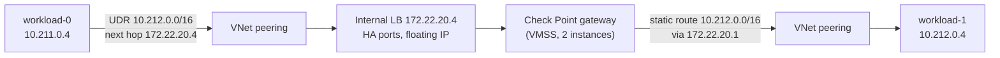

# East-west latency results (cross-VNet peering lab)

Measured on 2026-11-09 against a live CFWaaS **Cross vNet Peering Check Point
VMSS** lab (`addc8c0d`): two customer workload VNets, each peered directly to
the provider Check Point security VNet, with static UDRs sending east-west
(E-W) traffic through the firewall. There are no VPN gateways, Route Server or
Routing Appliance on the path.

This page repeats the
[latency test from the VPN lab](ew-performance-results.md#latency-icmp-round-trip-idle-path)
with the same script and parameters, so the two results can be compared.

> **Result in one line:** E-W traffic between the two workload VNets through
> the Check Point firewall has **p50 5.8 ms, p99 24.8 ms and p99.9 33.6 ms**
> round-trip latency, with no loss over 60,000 samples. That is about **half the
> median latency of the tuned VPN lab** (p50 10.6 ms).

How the tests were run: [E-W performance test plan](ew-performance-test-plan.md)
and [`scripts/ew_perf_test.py`](../scripts/ew_perf_test.py).

## Contents

- [E-W packet path as tested](#e-w-packet-path-as-tested)
- [Lab configuration under test](#lab-configuration-under-test)
- [Results](#results)
- [Comparison with the VPN lab](#comparison-with-the-vpn-lab)
- [What had to be fixed first](#what-had-to-be-fixed-first)
- [Findings and limits](#findings-and-limits)
- [How to reproduce](#how-to-reproduce)

## E-W packet path as tested

Each workload subnet has a UDR that sends the other workload prefix and
`0.0.0.0/0` to the internal load balancer frontend `172.22.20.4`. The
gateways route the customer prefixes back out of `eth1`, so every E-W packet
crosses VNet peering twice and the firewall once per direction.



Replies from workload-1 take the same path in the opposite direction through
the load balancer and a gateway. Source addresses are not translated: the
HTTP receiver on each VM sees the other VM's original private IP.

## Lab configuration under test

| Component | Configuration |
|---|---|
| Workload VMs | 2 x `Standard_D4s_v6` (4 vCPUs), accelerated networking (MANA), Ubuntu 24.04, kernel 6.17, MTU 9000 |
| Customer VNets | `10.211.0.0/16` and `10.212.0.0/16`, each peered only to the provider security VNet (`allowForwardedTraffic`, no gateway transit) |
| Workload routing | Static UDRs: other workload prefix and `0.0.0.0/0` to `172.22.20.4`; BGP propagation disabled |
| Provider security VNet | `172.22.0.0/16`, East US 2 |
| Internal load balancer | Standard, HA-ports rule with floating IP, TCP 8117 probe every 5 s |
| Check Point | R82 VMSS (image `8200.900779.2303`), **2 running instances** (`Standard_F4s`), management VM `Standard_F8s` |
| Gateway routing | Static routes: `10.211.0.0/16` and `10.212.0.0/16` via `172.22.20.1` (eth1), default via `172.22.10.1` (eth0) |
| Firewall policy | `faas-east-west` and `faas-north-south-egress` accept with service **Any**, track **Log** |
| Availability zones | None pinned (VMs, VMSS and load balancer are regional) |

## Results

### Latency (ICMP round trip, idle path)

Measured from `vm-peering-workload-0` to `vm-peering-workload-1`, 56-byte
payload, one ping every 10 ms, no throughput load running.

| Run | Samples | Loss | min | p50 | p90 | p99 | **p99.9** | max | avg |
|---|---|---|---|---|---|---|---|---|---|
| Short check | 3,000 | 0% | 1.45 ms | 5.51 ms | 11.6 ms | 26.4 ms | 41.5 ms | 52.5 ms | 6.66 ms |
| **Reference** | **60,000 (10 min)** | **0%** | **1.24 ms** | **5.76 ms** | **11.1 ms** | **24.8 ms** | **33.6 ms** | 58.9 ms | 6.68 ms |

The reference run is the one to quote. With 60,000 samples, p99.9 is the
60th-worst reply. The short run's p99.9 is higher because a handful of slow
replies dominate a 3,000-sample run.

The preflight pings in both directions (5 samples each) were consistent with
the reference run: p50 between 4.3 ms and 6.7 ms, no loss.

Throughput was not measured in this run.

## Comparison with the VPN lab

Reference runs, 60,000 samples each, same script and parameters.

| Lab | Path per direction | min | p50 | p90 | p99 | p99.9 | Loss |
|---|---|---|---|---|---|---|---|
| [VPN lab (customer-24, tuned)](ew-performance-results.md#latency-icmp-round-trip-idle-path) | Routing Appliance, 4 VPN gateway hops, 2 load balancers, firewall | 3.6 ms | 10.6 ms | 19.8 ms | 29.7 ms | 39.2 ms | 0.002% |
| **Cross-VNet peering lab** | VNet peering, internal load balancer, firewall | **1.24 ms** | **5.76 ms** | **11.1 ms** | **24.8 ms** | **33.6 ms** | **0%** |
| Difference | | -66% | **-46%** | -44% | -17% | -14% | |

Removing the VPN hops roughly halves the typical latency (p50 and p90). The
tail (p99, p99.9) improves much less, which points to the shared part of the
path, the firewall and load balancer, as the main source of slow replies.

## What had to be fixed first

The lab's built-in verification failed, and no E-W or Internet traffic passed,
until two problems were fixed by hand on the Check Point side. Both are the
same problems found in the
[VPN lab](ew-performance-results.md#what-changed-to-reach-these-numbers).

| # | Problem | Evidence | Fix |
|---|---|---|---|
| 1 | Internal load balancer forwarded nothing | Probe on TCP 8117 at 0% for both instances; `fw monitor` showed the gateway answering probes with TCP reset; `cloud_balancer_port = 0` | `fw ctl set int cloud_balancer_port 8117`, persisted in `fwkern.conf`. Both instances turned 100% healthy within about 3 minutes. |
| 2 | Firewall dropped all E-W and egress traffic | `fw monitor` showed packets reaching `eth1` but never passing inbound inspection; kernel drop debug: *Rulebase drop on layer Network rule 5* (cleanup rule) | `faas-east-west` and `faas-north-south-egress` had service `None`. Set to `Any`, published and installed policy. |

The workload NSG problem from the VPN lab did not occur here: the peering
template's workload NSG allows the lab prefixes explicitly.

Both fixes are in the runner code (`checkpoint_gaia.py`) but not yet in a
published runner image, so a newly deployed peering lab still needs them
applied by hand.

## Findings and limits

- **The firewall path sets the latency floor.** With no VPN gateways, the
  remaining hops are VNet peering, the internal load balancer and one Check
  Point gateway per direction. A minimum of 1.24 ms but a median of 5.8 ms
  suggests most of the time is spent in processing, not on the wire.
- **Not tuned yet.** Several factors were left at their defaults and may
  affect the result: small gateways (`Standard_F4s`), logging on every E-W
  connection (`Track: Log`), the firewall's inspection path for this traffic,
  and no availability-zone pinning (the VMs and gateways may be in different
  zones).
- **Ping is the latency method.** ICMP shows the network path, not
  application-level latency.
- **Subscription governance interfered with this lab too.** An automation
  principal rewrote the Check Point management NSG every hour during testing,
  removing admin access and, once, the rule that lets the gateways reach
  management. In the VPN lab, the Check Point management VM and one VMSS
  instance were also found deallocated. Repeat measurements need a governance
  exemption or must check that every component is running first.

## How to reproduce

```bash
# Short check: 3,000 pings (about 2 minutes)
python3 scripts/ew_perf_test.py \
  --subscription <customer-subscription-id> \
  --resource-group rg-faas-peering-<environment-id> \
  --client-vm vm-peering-workload-0 --server-vm vm-peering-workload-1 \
  --skip-throughput --load-streams 0 --ping-count 3000 --ping-interval 0.01

# Reference latency: 60,000 pings over 10 minutes
python3 scripts/ew_perf_test.py \
  --subscription <customer-subscription-id> \
  --resource-group rg-faas-peering-<environment-id> \
  --client-vm vm-peering-workload-0 --server-vm vm-peering-workload-1 \
  --skip-throughput --load-streams 0 --ping-count 60000 --ping-interval 0.01
```

Before running, check that both Check Point VMSS instances, the management VM
and both workload VMs are running, and that both internal load balancer
backends report 100% availability on the TCP 8117 probe.
