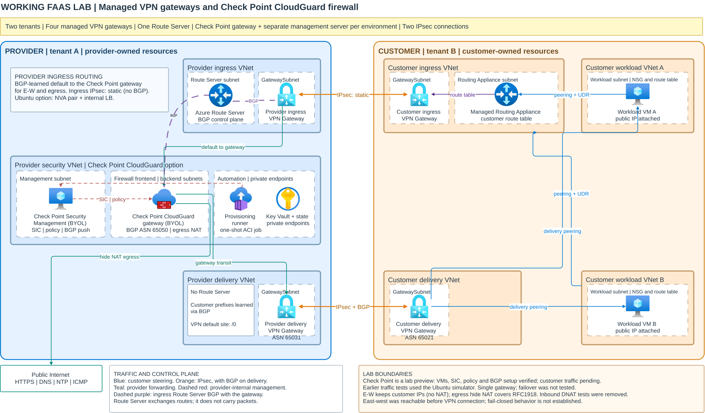

# East-west performance results (customer-24 lab)

Measured on 2026-11-09 against a live CFWaaS lab: one customer with two
workload VNets, inspected by one provider Check Point gateway over Azure VPN.
This page records what was measured, what had to change to get there, and
what is still open.

> **Result in one line:** after tuning, east-west (E-W) traffic between the two
> workload VNets reaches **about 2.2 Gbps in each direction** through the
> Check Point firewall, with **p50 10.6 ms, p99 29.7 ms and p99.9 39.2 ms**
> round-trip ping latency. On an open TCP connection, requests take
> **p50 2.9 ms / p99.9 20.8 ms**.

How the tests were run: [E-W performance test plan](ew-performance-test-plan.md)
and [`scripts/ew_perf_test.py`](../scripts/ew_perf_test.py).

The same latency test on the cross-VNet peering lab (no VPN gateways):
[E-W latency results, peering lab](ew-performance-results-peering.md).

## Contents

- [Lab topology](#lab-topology)
- [Lab configuration under test](#lab-configuration-under-test)
- [Results](#results)
- [What changed to reach these numbers](#what-changed-to-reach-these-numbers)
- [Findings and limits](#findings-and-limits)
- [Status of the changes in the deployment templates](#status-of-the-changes-in-the-deployment-templates)
- [How to reproduce](#how-to-reproduce)

## Lab topology

The lab is the standard working lab deployment:

[](../architecture/working-lab-topology.svg)

[Provider detail](../architecture/working-lab-topology-provider.svg) |
[Customer detail](../architecture/working-lab-topology-customer.svg) |
[Routing flow](../architecture/working-lab-routing.svg)

### E-W packet path as tested

Every E-W packet crosses the customer Routing Appliance, two VPN gateway pairs
and the firewall. The ingress path is a single static IPsec tunnel; the delivery
path is a four-tunnel BGP mesh with ECMP.

```mermaid
flowchart LR
    W0["workload-0<br/>10.211.0.4"] -->|UDR| RA["Customer Routing Appliance<br/>(ingress VNet)"]
    RA -->|UDR: VirtualNetworkGateway| CI["Customer ingress VPN GW<br/>VpnGw5AZ, single instance"]
    CI ==>|"1 IPsec tunnel, static<br/>GCMAES128"| PI["Provider ingress VPN GW<br/>VpnGw5AZ"]
    PI -->|"0.0.0.0/0 via Route Server"| FW["Check Point gateway<br/>(VMSS behind internal LB)"]
    FW --> PD["Provider delivery VPN GW<br/>VpnGw5AZ, active-active"]
    PD ==>|"4 IPsec tunnels, BGP ECMP<br/>GCMAES128"| CD["Customer delivery VPN GW<br/>VpnGw5AZ, active-active"]
    CD -->|VNet peering| W1["workload-1<br/>10.212.0.4"]
```



Replies from workload-1 take the same shape in the opposite direction:
workload-1, Routing Appliance, ingress tunnel, firewall, delivery mesh, then
workload-0.

## Lab configuration under test

| Component | Configuration |
|---|---|
| Workload VMs | 2 x `Standard_D8s_v6`, accelerated networking, Ubuntu, MTU 9000 |
| Customer Routing Appliance | 10 Gbps bandwidth |
| Customer ingress VPN gateway | `VpnGw5AZ`, **active-standby**, static routing |
| Customer delivery VPN gateway | `VpnGw5AZ`, **active-active**, BGP (ASN 65021) |
| Provider ingress VPN gateway | `VpnGw5AZ`, active-active, integrated with Azure Route Server (ASN 65515) |
| Provider delivery VPN gateway | `VpnGw5AZ`, **active-active**, BGP (ASN 65031) |
| IPsec policy (all connections) | IKE AES256/SHA256, DH group 14; IPsec **GCMAES128/GCMAES128**, PFS none |
| Check Point | R82 VMSS, **1 running instance** (`Standard_F4s`), management VM `Standard_F8s` |
| Firewall policy | `faas-east-west` and `faas-north-south-egress` accept with service **Any** |

## Results

### Throughput (iperf3 TCP, 20 s per run)

Each column is a configuration step, applied in order. Values are received
Gbps, forward (workload-0 to workload-1) / reverse.

| Parallel streams | 1. Baseline | 2. VPN SKU VpnGw5AZ | 3. + GCMAES128 | **4. + active-active delivery ECMP** |
|---|---|---|---|---|
| 1 | 0.37 / 0.35 | 0.41 / 0.41 | 0.91 / 0.65 | **0.76 / 0.84** |
| 8 | 0.46 / 0.47 | 0.66 / 0.70 | 1.15 / 1.70 | **1.78 / 1.98** |
| 16 | 0.44 / 0.44 | – | 1.10 / 2.15 | **1.82 / 2.21** |
| 32 | 0.42 / 0.41 | – | – | **2.23 / 2.20** |
| **Max** | **0.47** | **0.70** | **2.15** (one direction) | **~2.2 in both directions** |

Configurations:

1. Customer gateways downsized to `VpnGw2AZ` by subscription governance; IPsec encryption None + SHA256 integrity; all gateways single instance.
2. Customer gateways resized back to `VpnGw5AZ`.
3. IPsec policy changed to GCMAES128 on all four connections.
4. Delivery gateways (customer and provider) converted to active-active with a four-tunnel BGP mesh. Ingress unchanged.

### Latency (ICMP round trip, idle path)

| Run | Samples | Loss | min | p50 | p90 | p99 | **p99.9** | max |
|---|---|---|---|---|---|---|---|---|
| Configuration 3 (GCMAES128) | 3,000 | 0% | 4.8 ms | 9.7 ms | 19.5 ms | 32.0 ms | 41.4 ms | 41.8 ms |
| **Final, configuration 4** | **60,000 (10 min)** | **0.002%** | **3.6 ms** | **10.6 ms** | **19.8 ms** | **29.7 ms** | **39.2 ms** | 101 ms |

The final value is the reference: 60,000 samples make p99.9 the 60th-worst
reply, so it is statistically meaningful. Short runs (3,000 samples) can show
much higher p99.9 values because a single slow reply dominates.

The latency floor comes from the path itself: each direction crosses four VPN
gateway hops, two load balancers and the firewall. Active-active delivery
raised throughput without changing latency.

### Latency by protocol

Check Point inspects every ICMP echo as a new connection, so ping includes
the firewall's per-connection work. To show what applications see, the same
test was repeated with TCP ([EW-PERF-5](ew-performance-test-plan.md#test-matrix)):
a 32-byte request echoed by `vm-customer-workload-1`, once on **one open
connection** and once on **a new connection per request**.

Measured 2026-11-09 17:06–17:48 UTC on configuration 4, 60,000 samples per
method at 10 ms intervals, in parallel with the
[same test on the peering lab](ew-performance-results-peering.md#latency-by-protocol).
One Check Point instance was running.

| Method | Samples | Loss | min | p50 | p90 | p99 | **p99.9** | max | avg |
|---|---|---|---|---|---|---|---|---|---|
| ICMP echo | 60,000 | 0.002% | 3.74 ms | 10.4 ms | 19.6 ms | 29.9 ms | 41.0 ms | 107 ms | 13.9 ms |
| **TCP, open connection** | **60,000** | **0%** | **1.85 ms** | **2.87 ms** | **3.22 ms** | **6.09 ms** | **20.8 ms** | 81.7 ms | 2.97 ms |
| TCP, new connection | 60,000 | 0.023% | 7.56 ms | 14.0 ms | 24.7 ms | 34.9 ms | 47.4 ms | 287 ms | 17.0 ms |

The ping run matches the reference above (p50 10.4 ms versus 10.6 ms). On an
established connection, requests take **2.9 ms at p50**, about a quarter of
the ping value; that is what a kept-alive application connection sees. A new
connection per request costs more than ping, because it adds the TCP
handshake to the firewall's connection setup.

## What changed to reach these numbers

Before any performance number could be measured, E-W traffic had to work at all.
These are the problems found and fixed, in the order they appeared.

| # | Problem | Evidence | Fix |
|---|---|---|---|
| 1 | Firewall load balancer never forwarded traffic | LB health probe on TCP 8117 at 0% for the whole lab; gateway answered probes with TCP reset | Enable the Check Point kernel probe responder (`cloud_balancer_port=8117`). The pinned VMSS bootstrap sets `setHealthProbe` to false. |
| 2 | Firewall dropped all E-W and N-S traffic | `fw ctl zdebug drop`: *Rulebase drop on layer Network rule 5* (silent cleanup rule) | The FaaS rules were created without a service and defaulted to `None` (matches nothing). Set service to `Any`. |
| 3 | E-W traffic dropped at the destination VM | Packets forwarded by the firewall, none received by the workload | Workload NSG had a custom `deny-other-inbound` (200); governance kept stripping the allow rules above it. Removed the custom deny so Azure's default `AllowVnetInBound` applies. Internet inbound stays blocked by the default `DenyAllInBound`. |
| 4 | Low throughput (0.47 Gbps) | Firewall CPU about 5%; both VPN tunnels plateaued at about 95,000 packets per second | Customer gateways back to `VpnGw5AZ`, then IPsec policy changed from None + SHA256 (software hashing) to **GCMAES128** (hardware accelerated). |
| 5 | One tunnel per direction caps throughput | Retransmits rising at 8+ streams | Delivery gateways made **active-active** with two local network gateways and two connections per side, giving a four-tunnel BGP ECMP mesh. |

## Findings and limits

- **The Routing Appliance does not forward to an active-active VPN gateway.**
  When the customer ingress gateway was made active-active, all E-W and N-S
  traffic stopped. Network Watcher showed the path ending at the Routing
  Appliance, and a gateway packet capture showed no data reaching the
  gateway. Traffic returned the moment the gateway went back to a single
  instance. Microsoft's documentation does not state this limitation. **Keep the
  customer ingress gateway active-standby.**
- **Ingress cannot use BGP ECMP.** The provider ingress gateway must use ASN
  65515 because it is integrated with Azure Route Server, and Azure rejects
  65515 on a local network gateway. Ingress therefore stays a single static
  tunnel and is the likely remaining throughput limit.
- **The firewall is not the bottleneck yet.** One `Standard_F4s` instance stayed
  near 5% CPU at the original limit. Adding a second instance was deliberately
  not tested.
- **ICMP and TCP measure different things.** Ping includes the firewall's
  per-connection inspection on every packet; TCP on an open connection shows
  what an established application flow sees (p50 2.9 ms versus 10.4 ms).
  See [Latency by protocol](#latency-by-protocol).

### Subscription governance interfered with the lab

The lab subscription is governed by `MCAPSGovernance-AutomationApp`. During
the test it:

- downsized the customer VPN gateways from `VpnGw5AZ` to `VpnGw2AZ`;
- rewrote the workload NSG several times, removing allow rules;
- deallocated VMs repeatedly: the Check Point VMSS instances, the Check Point
  management VM and the workload VMs. Most of these stops have no caller in the
  activity log.

Azure Policy exemptions on the resource group did not stop this automation,
so it is not Azure Policy. Repeat measurements need a governance exemption
from the subscription owners, or must account for these interruptions.

## Status of the changes in the deployment templates

The tuned configuration was first applied to the live lab by hand. New lab
deployments now get it from the templates (published 2026-11-09):

| Change | In the templates? |
|---|---|
| Workload NSG without the custom deny rule | Yes (`customer-foundation.bicep`) |
| GCMAES128 IPsec policy on all connections | Yes (`modules/connection.bicep` default) |
| Active-active delivery gateways with a four-tunnel BGP mesh | Yes (customer and provider templates exchange the second instance's public IP and BGP address) |
| Customer ingress gateway kept active-standby | Yes (unchanged default, now documented) |
| Check Point rules with service `Any` | In the runner code, not yet published |
| Check Point probe responder on TCP 8117 | In the runner code, not yet published |

## How to reproduce

```bash
# Short check: throughput sweep plus 3,000 pings (about 10 minutes)
python3 scripts/ew_perf_test.py \
  --subscription <subscription-id> --resource-group <customer-resource-group> \
  --streams 1,8,16,32 --duration 20 --ping-count 3000 --load-streams 0

# Reference latency: 60,000 pings over 10 minutes, no throughput tests
python3 scripts/ew_perf_test.py \
  --subscription <subscription-id> --resource-group <customer-resource-group> \
  --skip-throughput --ping-count 60000 --ping-interval 0.01 --load-streams 0

# Latency by protocol: ping, TCP open connection and TCP new connection
# (60,000 samples each, about 35 minutes)
python3 scripts/ew_perf_test.py \
  --subscription <subscription-id> --resource-group <customer-resource-group> \
  --skip-throughput --tcp-latency --ping-count 60000 --ping-interval 0.01 --load-streams 0
```

Check the preconditions in the [test plan](ew-performance-test-plan.md#preconditions)
first, especially that every Check Point instance and both workload VMs are
running.
