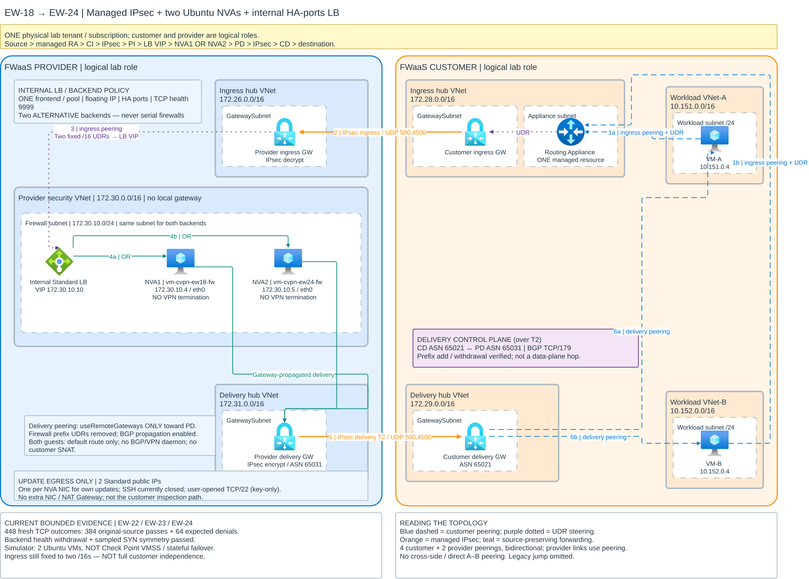

# Historical EW-18 research and manual deployment reference

> **Historical reference only.** The previous lab resources were deleted and
> the manual provider commands below are superseded. Do not follow this file
> to start a new deployment; use the [current deployment guide](../README.md).

The **historically passed EW-18 lab**, evolved through EW-24, demonstrates
source-preserving inspection between workload VNets, with **no
customer-to-provider VNet peering**. It was tested with logical customer and
provider roles in **one physical tenant and subscription**; this is not a
production or cross-tenant deployment qualification.

**Cleanup status (2026-10-28):** following explicit scope approval, the current
two-tenant deployment and the older lab were deleted. All five approved resource
groups were verified absent. The old API credential was revoked and its two app
registrations/service principals removed. The measurements below are historical,
not evidence of currently running resources. See the
[audit and cleanup outcome](../provider-provisioning/README.md#audit-and-cleanup-2026-10-28).
No replacement resources are currently running. A new browser-admin build is
being prepared; independent-authentication experiments remain unimplemented.

**Provider administration implementation:** browser-based customer onboarding,
Key Vault credential custody and rotation/revocation/recovery are now implemented
for local validation. The new provider-only ARM installer and explicit Entra
consent steps are documented in the
[provider administration guide](../provider-provisioning/README.md#browser-based-provider-administration).
This management release is not yet Azure-qualified. It keeps the customer
API-secret flow; it does not claim secret-free Marketplace onboarding.

## Two-tenant customer-initiated deployment automation

[Customer-initiated provider provisioning](provider-provisioning-flow.md)
explains separate customer/provider identities, RBAC and API permissions,
one-time onboarding, asynchronous Bicep orchestration, VPN/BGP result exchange
and secret-handling boundaries. The locally validated implementation is in
[`provider-provisioning/`](../provider-provisioning/README.md): authenticated API,
durable provider worker, identity bootstrap and customer-triggered Bicep.
**The two-tenant PoC passed live deployment and bidirectional connectivity
qualification on 2026-10-27 in East US 2.** Ping and HTTP preserved workload
source addresses, with packet observations on the provider NVA simulators.
See the [acceptance results](../provider-provisioning/README.md#live-two-tenant-acceptance-2026-10-27).
It does not change the traffic-steering qualifications of the labs below.

## Deploy the two-tenant implementation

**Check Point administrators must never log into the customer tenant. Customer
administrators must never need access to the Check Point tenant.** These are
separate people/accounts operating in separate environments, not one operator
switching between two tenant sessions.

| Actor | Allowed environment | Responsibility |
| --- | --- | --- |
| Check Point administrator | Check Point tenant/subscription and provider workstation/CI only | Build/test/package code; register the provider API; deploy provider hosting, identities, scoped RBAC and dataplane |
| Customer administrator | Customer tenant/subscription, through Azure Portal only | Authorize local RG deployment/RBAC and subscription prerequisites; no customer Graph onboarding |
| Customer deployment identity | Network Contributor and metadata-only Reader on the selected customer RG; no provider Azure RBAC | Customer ARM operations only, separate from API authentication |
| Customer API-only client | Entra application in the Check Point tenant, custom API role only, **no Azure RBAC** | Authenticate API calls; never deploy Azure resources |
| Provider worker identity | Dedicated Check Point dataplane RG only | Deploy provider resources using its own ARM token |

**Customer deployment must be Azure Portal + Bicep only:** no customer-local
Python, Azure CLI, Cloud Shell, configuration file or journal. Scripts may run
inside Azure as part of the Bicep deployment. Credentials and tokens are never
shared between administrators.

**Implemented approach:** the customer uses an API-only credential for the
Check Point API and a separate customer managed identity for customer ARM.
The new provider setup never logs into or queries customer Azure/Graph.
The Bicep wizard creates its own customer identity/RG permissions; no customer
directory app-role grant or combined onboarding journals are required.
Provider hosting, authenticated operation-store access, the customer-initiated
Portal proof and the full two-tenant network have been verified live for the
documented lab configuration. The full-network wizard is prepared separately
from the proof; creating its deployment starts paid infrastructure on both sides.

**This is lab acceptance, not production Check Point or Marketplace qualification.**
Commands with `--execute`, directory bootstrap, Template Spec publishing and
feature registration change Azure resources or permissions. Obtain approval
before running them. Full networking creates four managed VPN gateways and four
VMs, with continuing charges; see the
[costs, exceptions and prerequisites](../provider-provisioning/README.md#cost-warning-before-live-execution).
An existing lab group must never be treated as an installation target or deleted
incidentally; the historical cleanup above had separate, explicit authorization.

### 1. Check Point administrator: local build and configuration

**Engineering/manual bootstrap reference:** the command-based sections below
describe the earlier development path. Routine administrators using the new
browser management platform follow the
[manual provider setup](../provider-provisioning/README.md#alternative-manual-provider-setup-browser-only)
and management UI instead; they do not execute these workstation commands.

**Run on the Check Point workstation or CI/CD only.** The customer does not
perform these steps.

Prerequisites: Azure CLI with Bicep, Python 3.12, valid SSH **public** keys,
and, for later provider Azure operations, authorized access to the **provider
tenant/subscription only**. Local validation, tests and packaging do not require
an Azure login to either tenant.

From the repository root:

```bash
cd "$(git rev-parse --show-toplevel)/provider-provisioning"
python3.12 -m venv .venv
source .venv/bin/activate
python -m pip install -r requirements-dev.txt

mkdir -p .local
chmod 700 .local
if [ ! -e .local/config.json ]; then
  (umask 077; cp scripts/config.example.json .local/config.json)
fi
chmod 600 .local/config.json
```

Edit `.local/config.json` using the
[configuration example](../provider-provisioning/scripts/config.example.json):

- **Provider:** tenant/subscription IDs, a new control-plane RG and a separate
  new provider dataplane RG.
- **Customer metadata:** IDs/names supplied through authorized customer
  onboarding. Knowing these identifiers does not authorize customer access.
- **Run settings:** run ID, name prefix, operator's public IPv4 `/32`,
  NVA/workload public SSH keys and customer SKU choices.

The approved, private `.azure/infrastructure-plan.json` must also exist and
match those scopes and RG prefixes. It is already prepared on the authorized
lab workstation; a fresh clone must obtain or prepare an approved private plan.
Do not bypass scope checks or publish private configuration. Customer
tenant/subscription/RG identifiers are approved service-enrollment metadata,
not proof that Check Point can access those resources. Do not request customer
Azure credentials or exchange private journals between companies.

Load the IDs from the correct private configuration rather than copying the
wrong GUID. **`tenantId` is the directory ID; `subscriptionId` is not a tenant
ID.** These commands work from any folder inside this Git repository:

```bash
cd "$(git rev-parse --show-toplevel)/provider-provisioning"
source .venv/bin/activate
export PROVIDER_TENANT_ID="$(python -c 'import json; print(json.load(open(".local/config.json"))["provider"]["tenantId"])')"
export PROVIDER_SUBSCRIPTION_ID="$(python -c 'import json; print(json.load(open(".local/config.json"))["provider"]["subscriptionId"])')"
```

Build, validate and package locally. **No tenant login is needed for these
three commands:**

```bash
cd "$(git rev-parse --show-toplevel)/provider-provisioning"
source .venv/bin/activate
python scripts/bootstrap.py validate-local
python -m pytest -q tests
python scripts/package_apps.py
```

The final command creates ignored `.local/apps.zip` and template-hash metadata.
Do not run these commands from the repository root or either `.local/` folder.
In particular, repository-root `tests/` is a different suite: its 36 passing
tests do not replace the provisioning project's tests.
Rebuild it after infrastructure/service changes, before configuring and
publishing the provider apps. All remaining commands below run from this same
`provider-provisioning/` directory and activated environment.

### 2. Check Point administrator: provider sign-in and API registration

For approved **provider** Azure/Entra operations, an authorized Check Point
administrator signs into the provider tenant only:

```bash
cd "$(git rev-parse --show-toplevel)/provider-provisioning"
source .venv/bin/activate
export PROVIDER_TENANT_ID="$(python -c 'import json; print(json.load(open(".local/config.json"))["provider"]["tenantId"])')"
az login --tenant "$PROVIDER_TENANT_ID"
```

Create the provider-owned resources with the independent setup tool:

```bash
python scripts/provider_setup.py groups --config .local/config.json --execute
python scripts/provider_setup.py api --config .local/config.json --execute
python scripts/provider_setup.py api-client --config .local/config.json --execute
```

These create only the two provider RGs, provider API application and one
customer-specific API client in the **provider** directory. They assign the
client only `FirewallDeployment.Request`, not an Azure role. A provider
directory denial stops setup; the tool never grants an administrator role.

Provider state is in ignored `.local/provider-journal.json` and
`.local/provider-identity.json`. The PoC's 24-hour API credential is saved
separately in `.local/customer-api-credential.json` with `0600` permissions and
never printed. Deliver that **customer-specific API credential** through an
approved secure channel, not Git, a template URL or an administrator login.

### 3. Two authentication paths, not shared tenant access

```text
Customer Azure-hosted script
  | customer-specific API credential -> provider Entra -> API-only access token
  +--> Check Point API --> provider worker MI --> provider ARM
  |
  +--> customer managed identity ----------------------> customer ARM
```

The API credential is **not** a Check Point administrator/worker credential.
The API-only client has no Azure RBAC; it can request only the entitled service
operations. The API validates the provider issuer, exact API audience, caller
and role, then derives customer ownership/quota from its server-owned mapping.
It does not mistake the token's provider issuer tenant for the business customer.

The customer Bicep creates a customer UAMI, Network Contributor and Reader **only on
the selected customer RG**, using the customer's own ARM deployment authority.
No customer Entra application, customer Graph grant or directory-admin login
is required by this authentication mode. Customer deployment needs Owner, or
Contributor plus Role Based Access Control Administrator, on the enrolled RG.

### 4. Check Point administrator: provider hosting and worker

```bash
az login --tenant "$PROVIDER_TENANT_ID"
python scripts/provider_setup.py control-plane --config .local/config.json \
  --execute --approve-scm-bootstrap-exception
```

This deploys the B1 hosting plan, separate API/worker managed identities, private
Operations storage and Key Vault, and narrowly scoped RBAC. The API has no
provider infrastructure deployment role. The worker has Contributor **only on
the dedicated provider dataplane RG**, not the subscription.

The SCM exception allows Entra-authenticated code publishing from the configured
operator `/32`; basic publishing authentication stays disabled and worker
application ingress denies all. Provider gateway/VM provisioning is deferred
until a customer network request.

If direct SCM upload is blocked by a relay/proxy source IP, do not broaden the
allowlist or enable basic authentication. Create the approved provider artifact
host, using the provider publishing operator's **object ID** (never the API-only
client ID), then upload the byte-pinned ZIP:

```bash
python scripts/provider_artifacts.py host --config .local/config.json \
  --publisher-principal-id "$PROVIDER_PUBLISHER_OBJECT_ID" \
  --publisher-principal-type User --execute
python scripts/provider_artifacts.py upload --config .local/config.json \
  --file .local/apps.zip --blob-name packages/provider-apps.zip \
  --uri-output .local/apps-pull-uri.json --execute
python scripts/provider_setup.py code-deploy --config .local/config.json \
  --package-uri-file .local/apps-pull-uri.json --execute
```

This uses ARM OneDeploy to pull an authenticated, read-only provider blob URL;
the SAS is in a private parameter file, not command arguments or outputs.
Upload names are immutable: use a new version/hash path after rebuilding.
Existing URI output files are not overwritten. The artifact account must allow
the approved HTTPS network route while **anonymous blobs and shared keys stay
disabled**. If provider security governance disables networking, stop and get
an approved artifact route/configuration; do not override the policy.

### 5. Prepare a harmless customer proof first

The Check Point administrator prepares a customer ARM/Form pair using only
provider state. There is no customer-subscription read or customer journal:

```bash
python scripts/prepare_customer_portal.py --config .local/config.json \
  --execute --proof-only --output .local/customer-proof
```

This writes `azuredeploy.json`, `uiFormDefinition.json` and profile metadata.
The API secret is a required secure customer input and is never embedded in
those files. The proof creates only customer identity/RG setup, temporary Azure
execution resources and a harmless provider route table, **not gateways/VMs**.
It does not require the provider VM host-encryption feature.

**Portal file format:** do not load a `.bicep` source file into the Portal's
JSON template editor. The provider compiles Bicep during preparation.
`azuredeploy.json` is the deployable ARM JSON; `uiFormDefinition.json` is the
separate wizard definition, not an ARM template. Neither is the private
`.local/config.json`. A one-click link loads the ARM JSON and form together;
the customer should not need to upload source files.

### 6. Each administrator checks only their own prerequisites

The Check Point administrator checks/registers provider features and quotas in
the provider subscription. The customer administrator checks/registers customer
features and quotas in the customer subscription. Neither needs a login or
subscription-read permission on the other side.

Both sides' VMs require `Microsoft.Compute/EncryptionAtHost` registration.
The provider-only tool checks provider features only. Customer private workload
update/security-agent egress and customer feature registration remain
customer-owned prerequisites in Azure Portal.

### 7. Publish the customer wizard without customer Azure access

After the proof and separate full-network approval, Check Point prepares the
full deployment; this time it checks its own VM prerequisites:

```bash
python scripts/prepare_customer_portal.py --config .local/config.json --execute
```

Check Point hosts the generated ARM/Form files on its own approved HTTPS
artifact service, for example private provider blobs with short-lived,
read-only single-blob SAS URLs. This is **artifact download**, not customer
Azure RBAC. Do not publish a Template Spec into the customer subscription or
ask the customer to run publication commands. Never embed the API credential
in the files or their URLs.

For a protected launch link, save the two published URLs as `templateUri` and
`formUri` in a `0600` `.local/artifact-uris.json`, then run:

```bash
python scripts/prepare_customer_portal.py --config .local/config.json \
  --execute --artifact-uris .local/artifact-uris.json
```

The encoded Portal launch URL is saved privately in
`.local/customer-portal/launch.json`, not printed. Give the customer that link
and their separate API credential through approved channels. Hosting/upload
and SAS issuance use Check Point permissions only; this code does not
automatically create or publish an artifact host.

The customer wizard offers these defaults:

```json
{
  "routingApplianceBandwidthGbps": 10,
  "customerIngressVpnGatewaySku": "VpnGw1AZ",
  "customerDeliveryVpnGatewaySku": "VpnGw1AZ"
}
```

Defaults are the existing verified **10-Gbps Routing Appliance** option and
**VpnGw1AZ** for both customer gateways. Other supported gateway choices are
VpnGw2AZ–VpnGw5AZ. Basic is excluded because delivery requires BGP.
Provider sizing remains provider-controlled.

The customer administrator owns deployment/RBAC-assignment rights on the
enrolled customer RG. The customer user needs no provider Azure RBAC or
directory administrator role.

### 8. Customer end user: deploy through Azure Portal only

1. Open the **Deploy to Azure** link supplied by Check Point.
2. Select the enrolled customer subscription and create or select a dedicated
   resource group. The name is not fixed and needs no lab-specific prefix.
3. Select **Customer resource region**: East US 2 (default), East US,
   North Europe, West Europe or Israel Central; then choose the Routing
   Appliance and ingress/delivery VPN SKUs.
4. Enter the customer-specific API credential into the secure field.
5. Confirm the public SSH key and the temporary Azure-hosted execution/storage
   acknowledgement, then select **Review + Create > Create**.
6. Monitor the Azure deployment and its operation ID/status outputs.

The complete [customer Bicep entrypoint](../provider-provisioning/infra/customer-deployment.bicep)
automatically validates RG ownership and API authorization through the proof
before creating customer gateways/VMs. It then creates the customer Routing
Appliance, workloads and VPN gateways, and launches the Azure-hosted connector:

1. Sends customer VPN endpoints to the provider API.
2. Waits for the provider worker to deploy its two gateways, two NVA simulators
   and internal LB.
3. Reads the owner-authorized nonsecret manifest and protected IPsec keys.
4. Creates reciprocal customer connections using customer-owned ARM authority,
   without provider credentials or provider Azure RBAC.

The [Portal form](../provider-provisioning/portal/customer-form.json) is attached
to that complete deployment, not just the foundation. No customer-side Python,
CLI, Cloud Shell, local state files or extra deployment command is required.
Customer Azure permissions and prerequisites remain customer-owned. No
customer-directory API grant is needed: the API-only identity and role live in
Check Point's tenant. See the
[detailed publishing and customer instructions](../provider-provisioning/README.md#customer-end-user-steps-no-commands).

The selected region controls customer gateways, Routing Appliance, VMs and
reciprocal connections, not provider placement. Azure-hosted automation runs in
East US 2. The region catalog reflects provider-advertised resource and public
IP zone support; customer capacity, feature registration, policy and actual
regional deployment still need validation. The ResourceScope Region field is
for RG metadata; the separate **Customer resource region** selects workloads.

The customer UAMI receives Network Contributor plus metadata-only Reader on
the selected RG, never on another subscription. A preflight rejects the wrong
tenant/subscription or foreign network/VM resources before gateways/VMs and RG
enrollment tags are written. A stable per-RG run ID prevents retries for
different RGs from reusing one operation. This is for new deployments, not
automatic moves of existing gateways between regions.

### 9. Verify before cutover or old-lab deletion

`Ready` means ARM provisioning completed, **not** inspection qualification.
Verify VM/cloud-init/security-agent readiness, IPsec, delivery BGP, both traffic
directions with original sources, selective deny/recovery and fresh-flow backend
failover. Ingress remains fixed-prefix; this does not qualify arbitrary-prefix
insertion or a real Check Point product.

Do not delete an existing lab as part of installation.
[The separate cleanup gate](../provider-provisioning/README.md#separate-old-lab-cleanup)
requires fresh inventory, exact group/digest approval and replacement/cutover
verification.

**Legacy helpers:** `bootstrap.py groups`, customer CLI phases and
`bootstrap_identity.py customer` remain coordinated-lab/developer tooling.
They are not used by the independent provider/customer workflow above.
Never use their combined scope as a reason to grant Check Point customer
access. For production, credential storage, certificate authentication,
rotation/revocation and the live permission/inspection matrix still require
qualification; this PoC is not a Marketplace/native resource provider.

## Active lab: EW-18 managed VPN

EW-18 / EW-24 is the only active deployment candidate documented here.
The [EW-21 historical prototype](../archive/prototypes/ew21-ubuntu-overlay.md)
passed its measured tests but was archived by user decision on 2026-10-26;
it is **not a deployment candidate**. Repository archiving does not delete
Azure resources.

### Reading the large topology

The diagram occupies its own full-width block below, not a table thumbnail.
**Click the diagram or its "Open full-size topology" link for the large,
zoomable SVG**: EW-18 is **2333 x 1673 pixels**.
GitHub fits inline images to the README column; the direct SVG links let you
inspect the original size outside that column without losing vector detail.
Full-size links use GitHub's authenticated raw-file route; readers of this
private repository must be signed in with repository access.

## Connect to the lab VMs with SSH

Run these commands **from this repository's root on the lab workstation**.
The local helper selects the correct run-specific SSH configuration:

```bash
source .local/lab-ssh.env
```

### EW-18 / EW-24: both NVAs and both customer workloads

```bash
export SSH_CONFIG="$EW18_SSH_CONFIG"

ssh -F "$SSH_CONFIG" ew18-nva1
ssh -F "$SSH_CONFIG" ew18-nva2
ssh -F "$SSH_CONFIG" ew18-a
ssh -F "$SSH_CONFIG" ew18-b
```

The NVA aliases use their public endpoints. The private workload aliases use
NVA1 as a ProxyJump. The retained legacy jump VM is not part of this access
path and need not be started.

EW-18/EW-24 has a separate, user-requested any-source SSH lab exception.
Password authentication remains disabled, host keys are pinned from Azure,
and agent forwarding is disabled. Private VM commands require their NVA
jump host to be running.

**No private keys are stored in Git.** `.local/lab-ssh.env`, run-specific
SSH configurations, private keys and `known_hosts` remain ignored/local.
The helper contains config-file paths, not key contents. This README publishes
only connection commands and aliases.

A fresh clone on another machine does not contain these private artifacts:
use an authorized secure transfer or reprovision access. If the helper is
missing on the original workstation, locate the private configurations under
the relevant lab's `results/<run>/ssh-access/ssh_config` and set
`EW18_SSH_CONFIG` accordingly. Never paste a private key
into the README, chat or an issue.

## EW-18 managed VPN gateways

**Current evolution: EW-18 → EW-22/23/24 passed.** Source-preserving inter-VNet
inspection now uses **two Ubuntu NVA simulators behind one internal Standard
HA-ports load balancer**, with **all IPsec and delivery BGP on Azure VPN
Gateways**. Neither NVA runs VPN/BGP. There is **no customer-to-provider VNet
peering**. Both logical roles run in one physical test tenant/subscription.

This is a measured research lab, not a production-qualified Check Point service.
Actual Check Point VMSS, stateful session failover, throughput and fleet scale
remain unqualified. Delivery-prefix add/withdraw and new-flow backend health
withdrawal were tested; ingress still depends on two fixed workload `/16` UDRs,
so this is **not full arbitrary-prefix customer independence**.

<a href="https://github.com/roie9876/CFWaaS/raw/refs/heads/main/architecture/ew18-managed-vpn-inspection.svg">
  
</a>

[**Open full-size topology (2333 x 1673)**](https://github.com/roie9876/CFWaaS/raw/refs/heads/main/architecture/ew18-managed-vpn-inspection.svg) ·
[Editable Draw.io](../architecture/ew18-managed-vpn-inspection.drawio) ·
[Working configuration and operating guide](ew18-managed-vpn.md) ·
[Complete test register](test-register.md)

**How to read this topology:** traffic crosses the inspection IPsec tunnel,
passes through **NVA1 OR NVA2**, then crosses a separate delivery IPsec tunnel.
The two firewalls are alternative LB backends, **not serial inspection hops**.
Ingress and delivery gateways separate pre-inspection from post-inspection
routing; they are not an HA pair. BGP is delivery **control plane**, not another
packet hop. The diagram shows the current EW-24 continuation, not the original
single-firewall EW-18 baseline.

## EW-18 working packet path

Both initiation directions **and application responses** follow this pipeline:

```text
VM-A or VM-B
  -> ONE managed Virtual Network Routing Appliance
  -> customer ingress VPN gateway [172.28.0.0/16]
  -> IPsec -> provider ingress VPN gateway [172.26.0.0/16; decrypt]
  -> internal LB VIP 172.30.10.10 [security VNet 172.30.0.0/16]
  -> NVA1 172.30.10.4 OR NVA2 172.30.10.5 [forward/filter; not serial]
  -> provider delivery VPN gateway [172.31.0.0/16; encrypt]
  -> IPsec -> customer delivery VPN gateway [172.29.0.0/16]
  -> destination VM
```

The backends are `vm-cvpn-ew18-fw` and `vm-cvpn-ew24-fw`, both in
`172.30.10.0/24`. One LB frontend/pool uses floating-IP HA ports and TCP health
probes on **9999**. Capture ordinary traffic on **both NVAs' `eth0`**; neither
terminates IPsec or runs guest BGP, and customer traffic is not source-NATed.
Each NVA now has its own Standard public IP for **its own update egress**;
no extra NIC/NAT Gateway was added. At the user's explicit request, inbound
TCP/22 is now allowed from any source on the active lab NSGs. Key-only
authentication remains required; this is a temporary lab exposure, not a
production security recommendation.

**Delivery control plane, not a packet hop:** CD ASN **65021** ↔ PD ASN
**65031** exchanges BGP over delivery IPsec. Firewall per-prefix delivery UDRs
were removed and propagation enabled; each guest keeps its default route.

### Peering stays inside each side

- Each workload VNet peers with **both customer hubs**: an ingress peering and
  a delivery peering. Four relationships/eight directional objects.
- The provider security VNet peers with the provider ingress and delivery hubs.
  Two relationships/four directional objects.
- **No customer/provider peering**, no direct workload A/B peering, and no
  direct ingress/delivery hub peering.
- The provider firewall VNet has no local gateway and uses only the provider
  delivery gateway remotely. Post-inspection traffic does not return through
  the ingress gateway's inspection policy.

The diagram explicitly shows both customer peering sets. Four gateway roles
are shared **per isolated environment**, not one gateway per workload VNet.
Twenty-VNet operation was not tested.

## EW-18 continuation: current measured results

| Continuation | Result |
| --- | --- |
| EW-22 delivery BGP | Customer-only prefix addition/withdrawal learned dynamically, with provider configuration unchanged during the lifecycle |
| EW-23 propagated delivery | 24 HTTP outcomes: 18 original-source passes, six expected selective denials; temporary prefix also appeared/disappeared in NVA NIC routes |
| EW-24 two-backend matrix | **448 fresh TCP outcomes: 384 original-source passes + 64 expected denials**; both backends used, selective DROP evidence and recovery |
| EW-24 health / symmetry | Backend health withdrawal and sampled SYN/SYN-ACK symmetry passed; **not existing-session/stateful failover** |
| Own-VM update egress | Both NVAs reached the Microsoft repository with HTTP 200 and Defender extensions Succeeded; SSH subsequently opened explicitly for manual lab testing |

The temporary BGP prefix had no workload endpoint: route lifecycle is not a
claim of arbitrary-prefix end-to-end inspection. Ingress still uses fixed UDRs.

### Historical EW-18 baseline (before BGP and two-NVA LB)

| Test | Result |
| --- | --- |
| A-to-B and B-to-A HTTP, original source and correct receiver | **6/6 passed** |
| Block new A-to-B requests on the firewall | **3/3 denied; reverse 3/3 passed** |
| Block new B-to-A requests | **3/3 denied; reverse 3/3 passed** |
| Remove temporary blocks | **6/6 passed** |
| ICMP across the four-phase matrix | **16/16 replies** |
| Plain firewall capture | **448 E-W lines on `eth0`; no recirculation** |
| Managed IPsec | **All four connection ends Connected** |
| Final postflight | **Four VM agents/extensions ready; expected routes/remote gateway; no temporary blocks or private-source NAT** |

Firewall DROP counters increased during each selective-denial phase. This is
inspection evidence, not merely tunnel health or successful connectivity.
The table above records the original EW-18 milestone, not the latest matrix.
The EW-24 working configuration and all core resources were **left active/retained
at that milestone**, before the separately authorized 2026-10-28 cleanup.
Postflight is not continuous availability monitoring.
Resources incur charges while retained; the approved historical lab groups are
now deleted.

## EW-18 tenant independence

The architecture supports customer and provider resources in separate tenants:
IPsec connects endpoints without foreign-NIC attachment or cross-tenant VNet
peering. Microsoft documents [site-to-site connections across tenants and
subscriptions](https://learn.microsoft.com/azure/vpn-gateway/vpn-gateway-create-site-to-site-rm-powershell#tenants).

This particular lab placed both logical roles in one physical test tenant.
That describes the executed test, **not a tenant limitation on IPsec**.
Separate-tenant management/onboarding, real Check Point support and licensing
remain distinct qualifications.

## Other proven working references

These old cloud deployments were deleted with approval; their evidence remains.

| Reference | Proven scope |
| --- | --- |
| [EW-02: direct cross-tenant peering with AVNM](../deployments/02-direct-peering-avnm/README.md) | Ubuntu forwarding, original source, selective denial/recovery and environment isolation: 150 HTTP + 30 ICMP checks. Requires physical provider/customer peering |
| [EW-07: native secured vWAN / Azure Firewall](final-summary.md#5-what-native-routing-intent-did-differently) | Native Private Routing Intent inspection, selective denial and restoration. Not arbitrary external-NVA insertion |

AVNM is management automation, not a packet hop. Neither historical reference
is a substitute for EW-18's managed-VPN/plain-firewall requirement.

## Test history and archives

Read the [test register](test-register.md) **before another experiment**.
Use its stable IDs and cite existing results; a repeat needs a changed variable
or a recorded health/recovery reason.

- [Failed scenarios and path migration map](../archive/failed-scenarios/README.md).
- [EW-19: isolated no-appliance test](../archive/failed-scenarios/ew19-no-routing-appliance.md):
  the retained EW-18 control was untouched; direct-gateway steering bypassed
  inspection and protected-prefix variants were rejected for overlap.
  The isolated EW-19/EW-20 lab was deleted on 2026-10-22; local evidence is retained.
- [Prepared/unvalidated proposals](../archive/unvalidated-proposals/README.md):
  never-run designs are not mislabeled failed.
- [EW-17 prototype](../archive/prototypes/ew17-firewall-terminated-ipsec.md):
  passed packet tests but terminated VPN on Ubuntu, so it did **not** meet the
  clarified firewall-only requirement. It is not the current E-W path.
- [Passed prototype archive](../archive/prototypes/README.md), including
  [EW-21 Ubuntu/WireGuard](../archive/prototypes/ew21-ubuntu-overlay.md):
  archived by user decision, not failed and not a deployment candidate;
  historical measurements and SSH instructions are preserved, with no Azure
  resource deletion implied.
- [Historical findings through 2026-10-20](final-summary.md) and
  [historical architecture navigation](architecture.md).

Raw evidence, environment-bound controllers, approvals, SSH material and account
profiles stay private/local. Shared published helpers are imported from their
archive paths; the active lab and SSH paths were preserved. **Do not execute
archived controllers against deleted inventories.**

## Boundaries and offline validation

The EW-18 continuation qualifies a two-workload-VNet IPv4 simulator path with
fixed-prefix ingress and dynamic BGP delivery. Delivery prefix add/withdraw,
new-flow backend withdrawal and sampled symmetry passed, not full arbitrary-prefix
onboarding or stateful failover. Long-outage convergence, performance/MTU, IPv6, overlapping
environments, scale and persistence of guest test policy across reboot remain
unqualified. Earlier customer-initiated VM deallocations had no identified
actor; no unknown shutdown policy was disabled or claimed fixed.

```sh
python3 scripts/setup_local.py
python3 -B -m unittest discover -s tests -v
python3 scripts/check_publication.py --worktree
```

Offline validation does not authenticate or authorize deployment. See
[Contributing](../CONTRIBUTING.md), [publication/security](../SECURITY.md),
[monitoring](monitoring.md) and [GitHub handoff](github-preparation.md).
