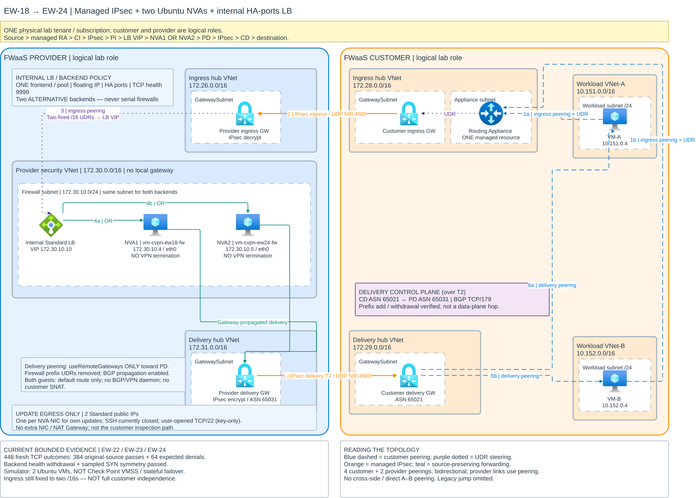

# EW-18 → EW-24: managed IPsec with two load-balanced Ubuntu NVAs

**Current result: passed and retained through EW-22/23/24.** The original EW-18
single-firewall path evolved into **two Ubuntu firewall simulators behind one
internal Standard HA-ports load balancer**, with BGP-learned delivery routes.
IPsec and BGP terminate on managed gateways, not guests. Customer inspection
traffic retains its source; there is no customer/provider VNet peering.
Both logical roles were tested in **one physical tenant/subscription**.
This is not Check Point VMSS, state-synchronized failover, or full arbitrary-prefix
customer independence: provider ingress still has two fixed workload `/16` UDRs.



[Full-size SVG](../architecture/ew18-managed-vpn-inspection.svg) ·
[Editable Draw.io](../architecture/ew18-managed-vpn-inspection.drawio) ·
[EW-21 historical archive; not a deployment candidate](../archive/prototypes/ew21-ubuntu-overlay.md) ·
[Full test register](test-register.md) · [Failed scenarios](../archive/failed-scenarios/README.md)

## Path and ownership

For traffic initiated in either workload VNet, including application responses:

```text
source -> one managed Routing Appliance -> customer ingress GW (172.28.0.0/16)
       -> IPsec -> provider ingress GW (172.26.0.0/16)
       -> internal LB VIP 172.30.10.10 (security VNet 172.30.0.0/16)
       -> NVA1 172.30.10.4 OR NVA2 172.30.10.5 (not serial firewalls)
       -> provider delivery GW (172.31.0.0/16)
       -> IPsec -> customer delivery GW (172.29.0.0/16) -> destination
```

| Side | VNet | Purpose |
| --- | --- | --- |
| Customer | Workload A / Workload B | Existing private workload VMs |
| Customer | Ingress hub | Existing Routing Appliance and customer ingress VPN gateway |
| Customer | Delivery hub | Customer delivery VPN gateway; native delivery to workload spokes |
| Provider | Ingress hub | Existing provider VPN gateway decrypts incoming inspected-service traffic |
| Provider | Security `172.30.0.0/16` | Internal Standard LB VIP `172.30.10.10`; both Ubuntu NVAs in firewall subnet `172.30.10.0/24`; no local gateway |
| Provider | NVA1 / NVA2 | `vm-cvpn-ew18-fw` / `vm-cvpn-ew24-fw`, private IPs `172.30.10.4` / `172.30.10.5`; forwarding/filtering only |
| Provider | Delivery hub | Provider VPN gateway encrypts post-inspection delivery; ASN **65031**, delivery BGP with customer ASN **65021** |
| Provider | Update/SSH access | Two Standard public IPs, one per NVA NIC; user-requested any-source TCP/22 now enabled for manual lab testing |

The LB has **one frontend and one backend pool**, a floating-IP HA-ports rule
and TCP health probes on **9999**. Each flow selects one alternative backend.
Readiness checks local forwarding/delivery routing; it does not replace end-to-end
packet acceptance. The public IPs are not customer-data next hops or a customer
SNAT design; no extra NIC or NAT Gateway was added.

Each workload VNet peers with **both customer hubs**: four relationships/eight
directional objects. The provider security VNet peers with both provider hubs:
two relationships/four directional objects. **All six relationships are internal
to their respective side. There is no customer/provider peering.** There is no
direct workload A/B or ingress/delivery hub peering.

The older provider Ubuntu is retained for SSH/rollback, not the inspected
firewall. Its direct VPN connections were removed and strongSwan stopped during
cutover. Retained old resources were not deleted.

## The routing-domain distinction

- Workload source UDRs select the one managed Routing Appliance.
- Appliance-subnet UDRs select the customer ingress gateway. That hub does not
  use workload gateway transit to bypass the service path.
- The provider ingress GatewaySubnet still uses two fixed protected `/16` UDRs,
  now toward **LB VIP `172.30.10.10`**, not either backend's private IP.
- EW-23 removed the security subnet's per-prefix delivery UDRs from
  `rt-ew18-firewall-delivery`; BGP propagation is enabled. Both NVA NICs select
  gateway-propagated routes; each guest needs only its default route to Azure.
  The security VNet peers with ingress and delivery, but uses
  **only provider delivery with `useRemoteGateways`** and has no local gateway.
  It does not send inspected traffic back to provider ingress.
- **Delivery control plane:** customer delivery ASN **65021** exchanges BGP
  with provider delivery ASN **65031** over the delivery IPsec tunnel.
  BGP is route distribution, not another packet-path hop. Neither NVA runs
  a BGP or VPN daemon, and customer inspection traffic is not source-NATed.
- Provider delivery encrypts toward customer delivery. The customer delivery
  hub has native workload reachability through gateway transit.
- Customer delivery and provider delivery GatewaySubnets have no inspection
  route back to the firewall.

This is the **tested combination** of separate ingress/delivery domains on both
sides, managed VPN endpoints and forwarding UDRs. It does not prove that merely
adding a second tunnel to the former shared gateway/RIB would fix the old loop.

### Why two provider gateways?

They represent **pre-inspection and post-inspection routing domains**, not an
HA pair or one gateway for requests and another for replies. Provider ingress
uses protected-destination UDRs toward the LB VIP. Provider delivery sends
the inspected packet into the customer delivery tunnel without reapplying that
ingress policy. The packet's original destination is unchanged after inspection;
an ordinary destination UDR does not carry an "already inspected" marker.

Sending the packet back through ingress risks reattraction to the firewall.
The separated delivery gateway avoids that in the measured design. Earlier
single-provider-gateway variants looped, but this is not proof that every
possible single-gateway design is impossible. No equivalent single-provider-GW
replacement has been qualified. Both initiation directions and responses use
the same ingress -> firewall -> delivery pipeline.

## Current measured results

| Continuation | Verified scope | Limit |
| --- | --- | --- |
| EW-22 | Delivery BGP learned/withdrew customer-only `10.173.0.0/16` addition/removal, with provider configuration unchanged during that lifecycle | No workload endpoint or packet proof for that temporary prefix |
| EW-23 | Firewall prefix UDRs removed, propagation enabled; 24 HTTP outcomes: 18 original-source deliveries and six selective denials | One-firewall milestone; ingress remained fixed-prefix |
| EW-24 | 448 fresh TCP outcomes: **384 original-source deliveries + 64 expected denials**, both backends used, positive DROP evidence and recovery | Two Ubuntu VMs, not actual Check Point VMSS |
| EW-24 resilience | Backend health withdrawal and sampled SYN/SYN-ACK symmetry passed in both directions | New-flow recovery, not state-synchronized existing-session failover |
| Update egress | Both NVAs reached `packages.microsoft.com` with HTTP 200; existing Defender extensions Succeeded | Own-VM updates, not customer egress qualification; SSH later opened for manual testing |

### Historical EW-18 single-firewall measurements

These original static-delivery measurements **predate BGP and the LB/two-NVA
continuations**; they are not the current EW-24 matrix.

| Phase | A-to-B HTTP | B-to-A HTTP | Other evidence |
| --- | --- | --- | --- |
| Allowed | 3/3 passed | 3/3 passed | Correct receiver and original source |
| A-to-B new SYNs blocked on firewall | 3/3 timed out | 3/3 passed | Healthy local/ICMP controls; 12 firewall DROP hits |
| B-to-A new SYNs blocked on firewall | 3/3 passed | 3/3 timed out | Healthy local/ICMP controls; 12 firewall DROP hits |
| Temporary blocks removed | 3/3 passed | 3/3 passed | Forwarding and allowed delivery restored |

All **16/16 ICMP packets** in the four-phase matrix received replies. The plain
firewall's **`eth0` capture recorded 448 E-W packet lines**, including original
request/reply addresses, with no correlated declining-TTL recirculation.
Packet lines are not unique packets: one ordinary forward is seen on receipt
and transmission.

All four managed connection ends were Connected. Firewall inspection verified:
no VPN software, no `xfrm`/VTI interfaces, no UDP/500 or UDP/4500 listener, and
no private-source NAT. Its interfaces were `lo` and `eth0`.

Final read-only postflight verified all four VM agents/extensions ready,
managed pairs Connected, provider route associations, the exclusive provider
delivery remote gateway, no direct-firewall VPN connections, no temporary
blocks and positive forwarding counters. **That working configuration was left
active at the EW-18 milestone.** Current state is described by EW-24 below;
neither postflight is continuous availability monitoring.

## Seeing packets

Capture on **both current NVA backends**, not the retained legacy Ubuntu jump:

```text
NVA1: vm-cvpn-ew18-fw   172.30.10.4
NVA2: vm-cvpn-ew24-fw   172.30.10.5
```

On each host, using an already authorized management session:

```sh
sudo tcpdump -ni eth0 'icmp and (host 10.151.0.4 or host 10.152.0.4)'
# For fresh TCP flows and sampled SYN/SYN-ACK symmetry:
sudo tcpdump -ni eth0 'tcp and (host 10.151.0.4 or host 10.152.0.4)'
```

On VM-A:

```sh
ping 10.152.0.4
```

The LB can select either backend; one host's empty capture does not prove bypass.
Generate fresh flows from both workloads and correlate original addresses and
forwarding/DROP counters across both captures. A ping alone does not cover backend
distribution or failover. Packet lines include receipt and transmission, not
unique flow counts.

At the user's explicit request, inbound TCP/22 is now allowed from any source
at both NIC and subnet NSGs for the four active lab VMs. Only the two NVA VMs
have public IPs; workload VMs remain private and use NVA1 as an SSH jump.
Password authentication remains disabled. All four alias connections were
verified with ARM-pinned host keys and the expected hostname.

This is a lab security exception: public SSH exposure should be removed or
restricted after manual testing. It is not a production recommendation.

Run the following in a terminal on the workstation containing the private
per-run SSH configuration (the configuration and private keys are not published):

```sh
SSH_CONFIG=/absolute/path/to/private/run/ssh-access/ssh_config
ssh -F "$SSH_CONFIG" ew18-nva1
ssh -F "$SSH_CONFIG" ew18-nva2
ssh -F "$SSH_CONFIG" ew18-a
ssh -F "$SSH_CONFIG" ew18-b
```

Historical `ravpn-plain-fw` referred to NVA1 only; `ravpn-fw` is the legacy jump,
not an inspected backend. Do not assume either alias provides current NVA2 access.

Unlike the earlier firewall-terminated [EW-17 prototype](../archive/prototypes/ew17-firewall-terminated-ipsec.md),
**no `xfrm0`/`xfrm1` capture is needed**. Azure gateways handle encryption and
decryption; Ubuntu receives and forwards ordinary IP packets.

## Tenant independence and limits

### EW-22: dynamic delivery continuation

On 2026-10-25, the existing customer/provider **delivery** pair was configured
with BGP using distinct ASNs and its actual private peer addresses. After the
provider learned both original workload `/16`s as `EBgp`, those workload
prefixes were removed from its delivery Local Network Gateway's static address
list. The customer delivery hub prefix remained as a static entry.

A customer-only address-space change then added a previously unconfigured
`10.173.0.0/16` prefix to an existing workload VNet and synchronized its
customer-delivery peering. Provider delivery learned the prefix over BGP.
Removing it and resynchronizing that peering withdrew the provider route.
The measured provider delivery gateway/site/connection settings and configured
route tables remained unchanged during that lifecycle. No provider script or
engineer action was performed between customer addition and withdrawal.

Final readback verified both delivery VPN ends and both BGP peers Connected,
the original workload routes learned as `EBgp`, removal of the temporary prefix,
and restoration of the customer's original VNet address space.

### EW-23: forwarding without per-prefix firewall delivery UDRs

The existing two workload VMs and plain firewall were started for a subsequent
data-plane test. The two exact workload routes were removed from
`rt-ew18-firewall-delivery`, leaving BGP propagation enabled. The firewall NIC
then selected active gateway-propagated routes for both workload prefixes.
The Ubuntu guest required only its existing default route to Azure, not
per-prefix guest routes or a BGP daemon.

All 24 HTTP attempts matched the four-phase expectation: 18 original-source
deliveries and six selective denials, with positive firewall DROP counters and
recovery in both directions. A customer-only addition/removal of
`10.173.0.0/16` also appeared/disappeared in the firewall NIC's effective routes,
not just the VPN gateway diagnostics.

This qualifies dynamic **delivery** through one firewall. Provider ingress
still uses fixed-prefix UDRs, and the new prefix had no workload data-plane
endpoint. Full arbitrary-prefix inspection remains unqualified.

### EW-24: two-NVA internal load-balancer continuation

One additional private Ubuntu NVA and one internal Standard HA-ports load
balancer were added in the existing provider security VNet. Both NVAs use
the dynamically learned Azure delivery routes without guest BGP or VPN.
The experiment retains one frontend and backend pool, with floating IP and
source-preserving forwarding. Health probes check local forwarding and
delivery-route selection, not access from an NVA's own address to a customer
application; end-to-end data-plane probes remain a separate acceptance gate.

Two-backend inspection, sampled flow symmetry and backend health-withdrawal
tests passed. The seven-phase matrix recorded 448 fresh TCP flow outcomes:
384 original-source deliveries and 64 expected selective denials. Capture and
forwarding-counter evidence demonstrated use of both backends; both selective
blocks required positive DROP evidence. With either backend's health withdrawn,
new flows reached only the surviving backend. Sampled SYN/SYN-ACK observations
were symmetric in both initiation directions, and final recovery passed.

Final live postflight verified both NVAs Running/ready, both Defender extensions
Succeeded, active readiness services, no temporary denial/health suppression or
capture PID, and working repository HTTPS. The ingress UDRs now select the
internal LB VIP. All resources remain retained pending later cleanup.

This is not a Check Point VMSS/state-synchronization or existing-session
failover qualification. **Ingress still uses the two original workload `/16`s;
arbitrary-prefix, provider-independent inspection is not yet qualified.**

Both NVA NICs now have explicitly approved Standard public IPs for the VMs'
own update traffic. No additional NIC or NAT Gateway was added. Before this
change, DNS worked but HTTPS to Microsoft's repository timed out and the new
VM's tenant-managed Defender extension failed repository setup. After public-IP
attachment, both NVAs received HTTP 200 from `packages.microsoft.com`, and a
retry of the existing Defender extension completed Succeeded.

Readback verified that private addresses, subnets, LB membership, NSGs and
inspection routes were unchanged by the attachment. Public SSH was initially
denied, then explicitly opened by the user for manual testing as described above.
The customer data path still requires source-preserving packet tests; public
update connectivity alone is not inspection qualification.

**At the EW-22 milestone, qualification was dynamic delivery-prefix discovery/withdrawal only.** It did
not create/delete a complete VNet, start the deallocated workload VMs, or run
packet probes for the temporary prefix. Provider ingress inspection UDRs,
firewall forwarding and prefix-specific NSGs remain separate dependencies.
End-to-end arbitrary-prefix inspection without provider changes is **not yet
qualified**. The historical EW-18 static-prefix results predate BGP; EW-23 and
EW-24 subsequently requalified packet forwarding for the original workloads,
not for the temporary prefix or arbitrary new customer VNets.

IPsec transport supports separate customer/provider tenants; neither foreign-NIC
attachment nor cross-tenant VNet peering is required. Microsoft documents
[site-to-site connections across tenants/subscriptions](https://learn.microsoft.com/azure/vpn-gateway/vpn-gateway-create-site-to-site-rm-powershell#tenants).
This lab instantiated both logical roles in one physical test tenant. Separate
tenant deployment permissions/onboarding were not exercised end to end.

This is an IPv4 Ubuntu forwarding/filtering qualification with dynamic delivery
and fixed-prefix ingress, **not**
a real Check Point or Microsoft/vendor production support commitment. It does
not qualify arbitrary-prefix end-to-end onboarding, stateful failover, long-outage
BGP convergence, throughput, MTU/load, IPv6, overlapping
environments, twenty-VNet operation or reboot persistence of guest test policy.
Four gateway roles are shared per isolated environment, not per workload VNet.

Earlier VM deallocations were classified Customer Initiated. Their exact actor
could not be identified from the scoped health/activity/schedule investigation;
no unknown policy was disabled. Do not treat that operational risk as fixed.

All core resources remain retained and billable. The EW-18 increment is roughly
USD 0.2308/hour base for the extra VpnGw1AZ and B1ms VM **at the original EW-18
milestone**, excluding disk, public-IP, peering/data and applicable charges.
That historical increment is not the current two-NVA/LB/two-public-IP cost total.
Environment-bound controllers, approved
plans, keys, host inventories and raw evidence remain private/local.
