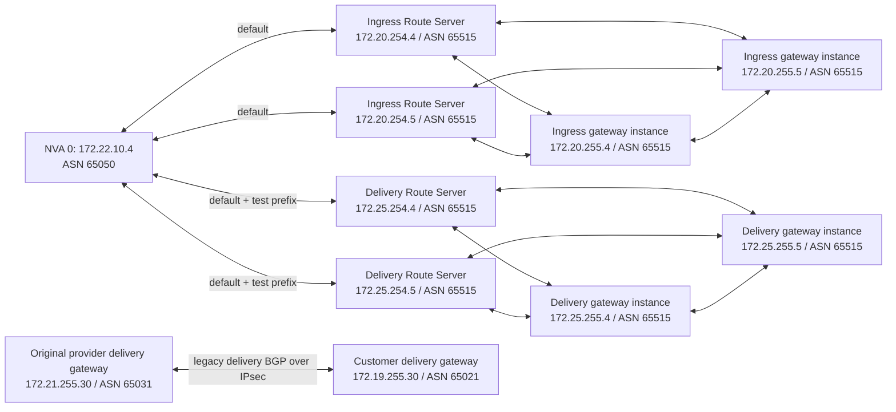
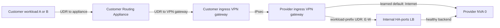
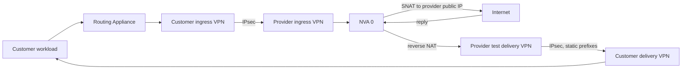
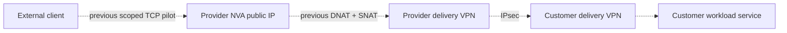

# Provider routing topology

This is a historical snapshot of the earlier customer-1 experiment, not the
current active path or a production/Check Point VMSS design. Its provider-only
test delivery VNet used `172.25.0.0/16`; the 2026-10-30 replacement originally
used `172.21.0.0/16`. The later active managed BGP delivery path is described in
the [current lab topology](../README.md#working-lab-topology).
The [editable BGP topology](../architecture/provider-bgp-peers.drawio) and
[rendered topology](../architecture/provider-bgp-peers.svg) depict the earlier
peers. For current results and limitations, see the
[replacement lab results](../provider-provisioning/README.md#replacement-lab-results-2026-10-30).

## BGP control plane

These are TCP/179 control-plane adjacencies, not packet-processing hops. Each
gateway instance peers with both co-located Route Server instances and with its
other active-active gateway instance. The legacy provider/customer delivery BGP
connection was connected, while the security VNet used the separate test
delivery gateway for the validated path. The historical delivery Route Server
also received a diagnostic benchmark prefix; the replacement NVA advertised only the default. At the
2026-10-30 replacement milestone, both customer-facing IPsec connections used
static local-gateway prefixes. The subsequently tested delivery connection uses
direct gateway-to-gateway BGP; ingress remains static.

## Workload ingress to provider

This is the shared first part of the east-west and Internet-egress paths. The
customer ingress gateway used its local gateway as its default site. NVA 1 was
deallocated in this historical snapshot; the replacement runs two NVAs, but
the LB is not evidence of working failover.

## East-West

```mermaid
flowchart LR
  A["Workload A"] --> RA["Routing Appliance"] --> CI["Customer ingress VPN"]
  CI -->|"IPsec"| PI["Provider ingress VPN"] --> LB["Internal LB"] --> NVA["NVA 0"]
  NVA -->|"delivery VNet peering"| PD["Provider test delivery VPN"]
  PD -->|"IPsec, static prefixes"| CD["Customer delivery VPN"] --> B["Workload B"]
```

The reverse direction follows the same sequence with B and A exchanged. The
Ubuntu simulator does not SNAT the workload-to-workload packets.

## North-South Egress And Return

The provider ingress and delivery Route Servers exchange NVA 0's BGP default
with their local VPN gateways. A separate `0.0.0.0/0` Internet UDR on the NVA
subnet prevents the NVA's own egress from looping back. No default UDR is placed
on a gateway subnet. The delivery gateway's learned default was necessary in
the withdrawal test; the platform's internal source-route behavior remains
unconfirmed.

## North-South Internet Ingress

**Historical path:** the earlier source-restricted pilot used temporary NVA
DNAT/SNAT rules. A later restricted SSH and ICMP probe passed on the active
BGP delivery path; its rules were removed. The deployment does not provide
permanent inbound publishing.

## Qualification

On 2026-10-30 NVA 0 was restarted after saving FRR and adding an ordered startup
unit for the two workload NAT rules. All four NVA BGP sessions re-established;
both workloads passed HTTPS IP-echo, Internet ICMP and 3/3 E-W pings. At that
time, the new deployment templates had not been deployed end to end. A second boot
exposed an FRR / network-online ordering cycle; after correction, another boot
restored all peers and NAT, and both workloads passed HTTPS and E-W checks.
At that milestone the templates retained fixed customer prefixes and source IPs.
The updated source and later lifecycle test are described in the
[test register](test-register.md#ew-27-customer-only-vnet-addition-and-withdrawal).
Real Check Point inspection, NVA 1 failover, fragmented traffic, and production
onboarding remain unproven. Route Servers and VPN gateways incur charges.